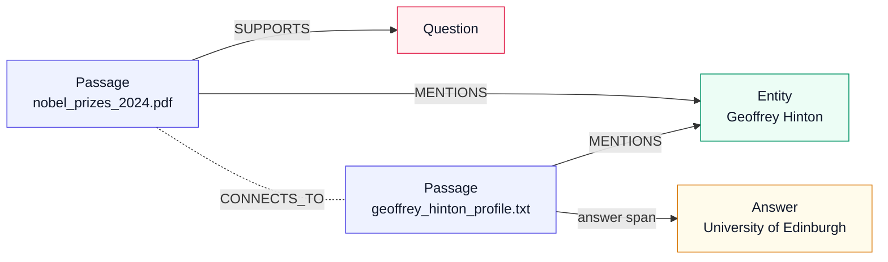
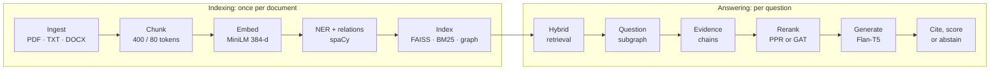
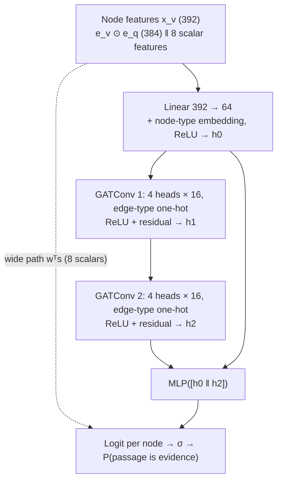
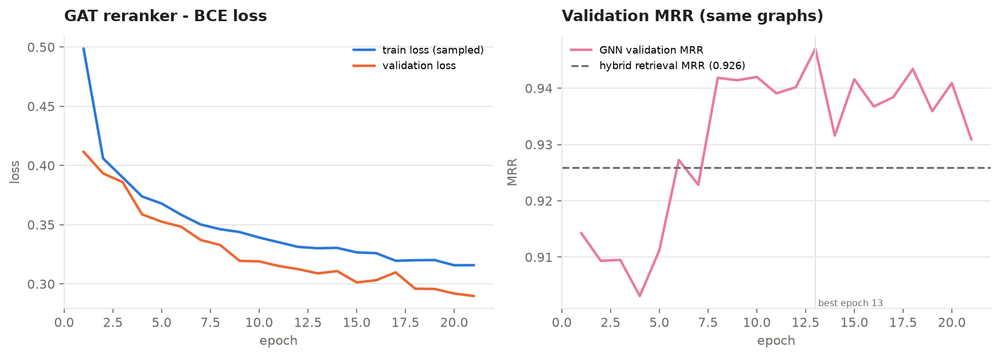
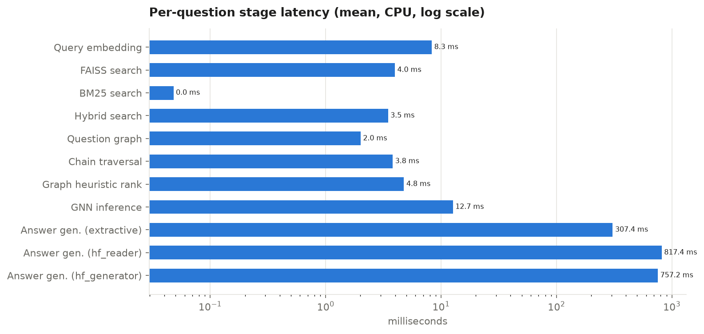
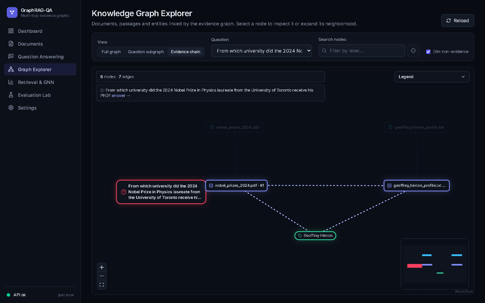
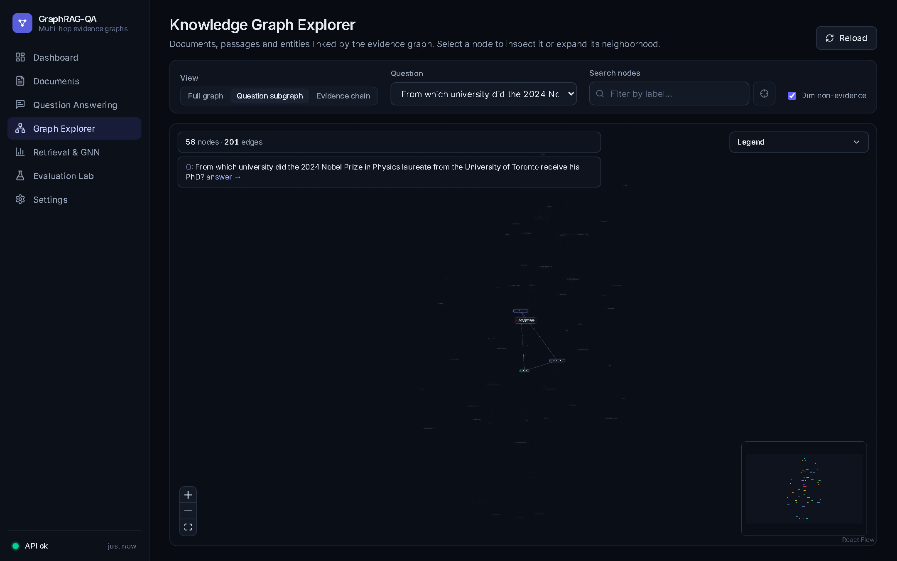
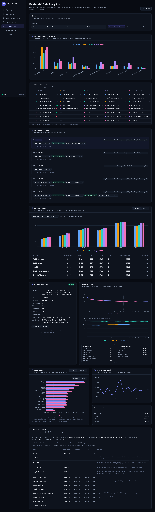
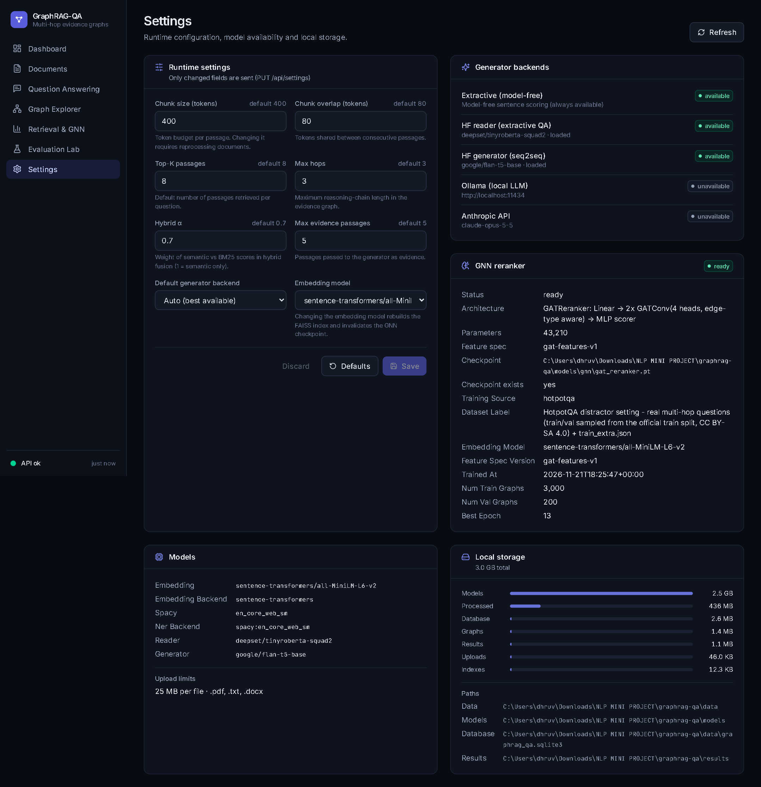

<div align="center">

# GraphRAG-QA

### Multi-hop question answering across multiple documents and Wikipedia, using evidence graphs and graph neural networks

[](#prerequisites)
[](#api-reference)
[](#using-the-web-application)
[](#the-gat-reranker)
[](#testing)
[](#prerequisites)
[](LICENSE)

**Dhruv Shah** (500118979) · **Manasvi Saxena** (500119549)<br>
Supervised by **Dr. Sujoy Chatterjee** · School of Computer Science (SoCS), UPES Dehradun · November 2026

[Project report (PDF)](docs/report/GraphRAG_QA_Project_Report.pdf) ·
[15-slide presentation](docs/presentation/GraphRAG_QA_15_Slides.pptx) ·
[Viva & demo script](docs/presentation/Viva_Demo_Script.md) ·
[Methodology](docs/methodology.md) ·
[Architecture](docs/architecture.md)

</div>

---

GraphRAG-QA answers questions whose answer is **spread over several documents**. It retrieves passages with a hybrid
dense + keyword retriever, links them in an **evidence graph** of documents, passages and named entities, searches that
graph for **multi-hop evidence chains**, reranks the evidence with a Personalized-PageRank heuristic or a trained
**Graph Attention Network (GAT)**, and generates an answer that is accepted **only if it is grounded in cited
passages**. When the evidence is not good enough it says *"Insufficient evidence found to answer this question
reliably."* instead of guessing.

Everything runs locally on a laptop CPU: no GPU, no paid API, no cloud service.

<p align="center">
  
</p>

### Results at a glance

Held-out **HotpotQA** sample: 300 questions from the official dev split, distractor setting, same answer generator for
every strategy. All numbers are measured and stored in [`results/`](results).

| Strategy | Exact match | F1 | Precision@2 | Evidence recall |
|---|---:|---:|---:|---:|
| Hybrid retrieval (FAISS + BM25) | 0.313 | 0.437 | 0.678 | 0.818 |
| Graph heuristic (PPR + chains) | **0.377** | **0.510** | 0.702 | 0.898 |
| GNN (GAT) reranker | 0.373 | 0.498 | **0.720** | **0.910** |

- **Both graph strategies beat retrieval-only ranking significantly** (paired bootstrap, 10,000 resamples, 95% CI).
- **The trained GAT and the hand-tuned heuristic are statistically tied.** The GAT matches the heuristic without
  hand-set weights; it is not significantly better.
- **The graph part is cheap:** question subgraph, chain search and GAT inference together take about 19 ms per
  question on a laptop CPU.

---

## Table of contents

1. [The problem, with an example](#the-problem-with-an-example)
2. [Key features](#key-features)
3. [System architecture](#system-architecture)
4. [How it works, step by step](#how-it-works-step-by-step)
5. [The GAT reranker](#the-gat-reranker)
6. [Experimental results](#experimental-results)
7. [Quick start](#quick-start)
8. [Installation in detail](#installation-in-detail)
9. [Configuration](#configuration)
10. [Running the application](#running-the-application)
11. [Using the web application](#using-the-web-application)
12. [Demo walkthrough and sample questions](#demo-walkthrough-and-sample-questions)
13. [API reference](#api-reference)
14. [Testing](#testing)
15. [Reproducing every result](#reproducing-every-result)
16. [Scripts reference](#scripts-reference)
17. [Project structure](#project-structure)
18. [Documentation index](#documentation-index)
19. [Datasets and licences](#datasets-and-licences)
20. [Troubleshooting](#troubleshooting)
21. [Limitations](#limitations)
22. [Future work](#future-work)
23. [References](#references)
24. [Authors, acknowledgements and citation](#authors-acknowledgements-and-citation)

---

## The problem, with an example

Retrieval-augmented generation (RAG) [1] retrieves the passages most similar to the question. **Multi-hop questions
break that assumption.** The passage holding the answer is often *not* similar to the question, because the question
describes the linking ("bridge") entity instead of naming it [2].

> **Question:** *From which university did the 2024 Nobel Prize in Physics laureate from the University of Toronto
> receive his PhD?*

| Hop | Document | What it says | Similar to the question? |
|---|---|---|---|
| 1 | `nobel_prizes_2024.pdf` | "…the Nobel Prize in Physics 2024 was awarded jointly to John J. Hopfield … and **Geoffrey E. Hinton** of the University of Toronto…" | Yes: Nobel, Physics, 2024, Toronto |
| 2 | `geoffrey_hinton_profile.txt` | "**Hinton** … then completed a PhD in artificial intelligence at the **University of Edinburgh** in 1978…" | Barely: no "Nobel", no "2024" |

A retriever that scores passages one at a time ranks hop 2 low. GraphRAG-QA connects the two passages through the
shared entity *Geoffrey Hinton*, finds the chain, answers **University of Edinburgh**, and cites both documents with
page numbers and the exact supporting sentences.



**Goals of the project**

1. Answer questions over the user's own PDF, TXT and DOCX files, or over Wikipedia.
2. Combine evidence from several sources and show the reasoning chain.
3. Cite every source (document, page, passage, exact sentence).
4. Refuse to answer when the evidence is insufficient.
5. Learn the evidence ranking with a graph neural network, and measure honestly whether it helps.

---

## Key features

| Area | What is implemented |
|---|---|
| **Ingestion** | PDF (PyMuPDF, page numbers), TXT (encoding detection, form-feed pages), DOCX (headings → sections, tables, page breaks); validation, size limit, safe filenames, duplicate detection |
| **Chunking** | Sentence-aware, 400-token windows with 80-token overlap, exact character offsets |
| **NLP** | spaCy named-entity recognition, verb-relation extraction, conservative duplicate-entity resolution, entity registry |
| **Retrieval** | FAISS (persistent, incremental add/remove), BM25, hybrid α·semantic + (1 − α)·BM25 |
| **Evidence graph** | NetworkX heterogeneous graph with 4 node types and 6 edge types; JSON + GraphML serialisation; pruning of hub entities |
| **Multi-hop reasoning** | Question subgraph expansion up to 3 hops, simple-path chain search with cycle prevention, scored and explained chains |
| **Reranking** | Personalized-PageRank graph heuristic; trainable 2-layer GAT (PyTorch Geometric) with negative sampling, validation, early stopping and checkpointing |
| **Answer generation** | Flan-T5 (local), extractive reader (local), model-free extractive fallback, optional Ollama or Claude API; grounding check; separate fact and inference steps |
| **Trust** | Validated citations (document, page, chunk, exact sentence, scores), confidence computed from measured signals, insufficient-evidence safeguard |
| **Open-domain mode** | Wikipedia search → articles → sections → bridge-entity second hop; SQLite cache |
| **Web application** | 7-page React dashboard: documents, question answering, interactive graph explorer (React Flow), analytics (Recharts), evaluation lab with CSV export, settings |
| **Quality** | 57 pytest tests (unit, integration, end-to-end, frontend contract), reproducible benchmark, significance test, 15 OOAD diagrams |

---

## System architecture

<p align="center">
  
</p>

| Layer | Contents |
|---|---|
| **Presentation** | React + TypeScript single-page app (Vite, Tailwind CSS, React Flow, Recharts): Dashboard, Documents, Question Answering, Graph Explorer, Retrieval & GNN analytics, Evaluation Lab, Settings |
| **API** | FastAPI + Pydantic v2, REST/JSON, background jobs for ingestion, evaluation and GNN training |
| **Processing** | Pipeline services wired by a composition-root container: ingestion → chunking → embedding → NER and relations → evidence graph → hybrid retrieval → chains → reranking → generation → citations and confidence |
| **Storage** | SQLite (documents, passages, entities, history), FAISS index, graph JSON/GraphML, model files including the GNN checkpoint |

The full OOAD diagram set (use case, class, six sequence diagrams, activity, component, deployment, DFD level 0/1, ER)
is in [`docs/diagrams/rendered/`](docs/diagrams/rendered), explained in [`docs/architecture.md`](docs/architecture.md).

### Technology stack

| Layer | Technology |
|---|---|
| Frontend | React, Vite, TypeScript, Tailwind CSS, React Flow (`@xyflow/react`), Recharts, Lucide icons |
| Backend | Python 3.11+ (tested with 3.13), FastAPI, Uvicorn, Pydantic v2 |
| NLP models | Sentence-Transformers `all-MiniLM-L6-v2` (384-d), spaCy `en_core_web_sm`, Hugging Face `google/flan-t5-base` and `deepset/tinyroberta-squad2` |
| Retrieval | FAISS (`faiss-cpu`), `rank_bm25` |
| Graph and GNN | NetworkX, PyTorch, PyTorch Geometric (`GATConv`) |
| Documents | PyMuPDF, python-docx |
| Storage | SQLite (Python standard library) |
| Testing | pytest, FastAPI TestClient (httpx) |
| Documentation | PlantUML and Mermaid diagrams, matplotlib, python-docx, python-pptx |

---

## How it works, step by step



### Indexing (once per document)

| Step | What happens | Measured time (demo corpus) |
|---|---|---|
| 1. Ingest | Validate, store and extract text per page; normalise whitespace and encoding | 0.5 s for 5 files |
| 2. Chunk | Sentence-aware windows of 400 tokens with 80-token overlap, with exact offsets | 1.2 ms for 8 chunks |
| 3. Embed | `all-MiniLM-L6-v2`, L2-normalised; long passages are the mean of ≤ 180-word sentence windows | 26.5 ms per passage |
| 4. Extract | spaCy NER + verb relations; entity duplicates merged only by exact normalised form, dropped middle initials, unique surname or unique acronym | 15 ms per passage |
| 5. Index | `faiss.IndexIDMap2(IndexFlatIP)` (exact cosine), BM25 Okapi (k1 = 1.5, b = 0.75), corpus evidence graph | 3.1 ms, 118 nodes / 527 edges |

### The evidence graph

Four node types (document, passage, entity, question) and six edge types, each backed by extracted text or metadata:

| Edge | Created when | Weight in PageRank |
|---|---|---:|
| `CONTAINS` | document → each of its passages | 0.2 |
| `SUPPORTS` | retrieved passage → question (weight = hybrid score) | 2.0 |
| `MENTIONS` | passage → entity it mentions (weight = count); question → entity | 1.0 |
| `RELATED_TO` | a verb links two entities; keeps the source sentence | 1.0 |
| `CO_OCCURS_WITH` | two entities in the same sentence | 0.5 |
| `CONNECTS_TO` | passages share a bridge entity, or are adjacent chunks of one document | 0.5 |

**Bridge-entity rule.** Dates are never bridges, and an entity may link passages only if it appears in at most
max(4, min(40, ⌊0.25·N⌋)) of the N passages, so hub entities such as "Google" do not connect everything. In
PageRank, entity edges are also scaled by the entity's specificity.

### Answering (per question)

1. **Hybrid retrieval.** The question is embedded; FAISS and BM25 candidates are merged and scored (formula below).
2. **Question subgraph.** A question node is added with `SUPPORTS` edges to the top-k passages, linked to its entities,
   and expanded through bridge entities up to `max_hops`.
3. **Evidence chains.** `networkx.all_simple_paths` from the question node over passages (at most 6 neighbours per
   passage and 5,000 paths), each path scored for relevance, term coverage and bridge specificity.
4. **Reranking.** Either the graph heuristic (hybrid + PageRank + chain support) or the trained GAT scores every
   passage. With the GAT, chains are re-scored with the GAT probabilities.
5. **Grounded generation.** Flan-T5-base reads the top 5 evidence passages with a cautious prompt that allows
   "unanswerable". If it abstains, a plain reading-comprehension pass may still answer, at half support and only if
   the answer is grounded in the evidence.
6. **Verification.** Citations are validated; the confidence score is computed; three gates decide whether to answer
   or abstain.

### The scoring formulas

**Hybrid retrieval** (α = 0.7)

$$H(p)=\alpha\,\max\big(0,\cos(e_q,e_p)\big)+(1-\alpha)\,\frac{\mathrm{BM25}(q,p)}{\max_{p'}\mathrm{BM25}(q,p')}$$

**Evidence-chain score** for a chain $C$ of $n$ passages

$$S(C)=0.45\,R(C)+0.40\,\mathrm{Cov}_{idf}(C)+0.15\,B(C)-0.03\,(n-1),\qquad R(C)=0.7\,rel(p_1)+0.3\,\mathrm{mean}\,rel(p_{2..n})$$

$\mathrm{Cov}_{idf}$ is the IDF-weighted share of question terms covered by the chain; $B$ is the specificity of the
bridge entities (only when $n>1$).

**Graph heuristic** (Personalized PageRank [19], [20] with damping 0.85, restarting at the question node)

$$G(p)=0.5\,H(p)+0.25\,\frac{\mathrm{PPR}(p)}{\max\mathrm{PPR}}+0.25\,\frac{\max_{C\ni p}S(C)}{\max_C S(C)}$$

**Confidence** (computed from measurable signals, never by a language model)

$$\mathrm{conf}=0.30\,S_{ret}+0.25\,S_{cov}+0.15\,S_{chain}+0.30\,S_{ans}$$

| Component | Meaning |
|---|---|
| $S_{ret}$ | best cosine between the question and an evidence passage, rescaled from [0.10, 0.70] to [0, 1] |
| $S_{cov}$ | share of question content terms that occur in the evidence |
| $S_{chain}$ | score of the best evidence chain (0 when no chain is used) |
| $S_{ans}$ | answer support from the generator; halved if the cautious prompt abstained; 0 if the answer cannot be verified |

**Abstention gates.** The system answers only if (1) the best passage reaches cosine ≥ 0.22 and question-term coverage
≥ 0.30, (2) the entities named in the question occur in the evidence, and (3) the confidence is ≥ 0.30. Otherwise it
returns *"Insufficient evidence found to answer this question reliably."* together with the failed checks.

Full derivations: [`docs/methodology.md`](docs/methodology.md).

---

## The GAT reranker



**Node features (392 dimensions).** The element-wise product of the node embedding with the question embedding (384)
plus 8 scalars: cosine to the question, BM25, hybrid score, is-seed, hop distance, is-question-entity, log-degree and
entity specificity.

**Attention** [3], [21]: $\alpha_{ij}=\mathrm{softmax}_j\big(\mathrm{LeakyReLU}(a^\top[Wh_i\,\|\,Wh_j\,\|\,W_e e_{ij}])\big)$,
where $e_{ij}$ is the one-hot edge type.

**Why the wide path.** A first version without it ranked below hybrid retrieval on validation: the strongest single
signals were diluted inside the 392-d projection. The linear path from the 8 scalars straight to the logit fixed that.

| Training setting | Value |
|---|---|
| Data | 3,000 HotpotQA training questions (1,000 + 2,000 extra, disjoint) / 200 validation questions |
| Labels | gold supporting paragraphs = 1, all other passages = 0 |
| Loss | binary cross-entropy, 3 negatives per positive (half of them hard, chosen by hybrid score) |
| Optimiser | Adam [23], learning rate 0.001, weight decay 0.0001 |
| Regularisation | dropout 0.2, batch size 16, hidden size 64 |
| Early stopping | validation MRR, patience 8 → best epoch 13 of 21 |
| Size and cost | 43,210 parameters; 179 s of training (≈ 25 min of graph and feature construction) on a laptop CPU |

| Validation (200 questions) | Hybrid | Heuristic | **GAT** |
|---|---:|---:|---:|
| MRR | 0.926 | 0.937 | **0.947** |
| Precision@2 | 0.700 | 0.720 | **0.745** |
| Both gold paragraphs in top 2 | 0.455 | 0.490 | **0.540** |

The GNN is never used untrained: without a compatible checkpoint the system falls back to the graph heuristic and says
so in the response.

---

## Experimental results

All numbers were produced by `python scripts/run_benchmark.py` on a laptop CPU (Intel, 16 logical cores, 15.6 GB RAM,
Windows 11, Python 3.13, no GPU) and are stored in [`results/`](results). They are measurements, not estimates. With
exactly two gold paragraphs per HotpotQA question, P@2 and R@2 coincide.

### Held-out HotpotQA test sample

300 questions from the official dev split (243 bridge, 57 comparison), distractor setting (each question is answered
over its own 10 paragraphs: 2 gold, 8 distractors). Configuration: top-k 4, max hops 2, k = 2, α = 0.7, Flan-T5-base.

| Strategy | EM | F1 | P@2 = R@2 | MRR | Evidence recall | Citation coverage | Citation precision | False abstention |
|---|---:|---:|---:|---:|---:|---:|---:|---:|
| FAISS (dense) | 0.300 | 0.414 | 0.615 | 0.894 | 0.777 | 0.337 | 0.672 | 0.107 |
| BM25 (lexical) | 0.333 | 0.452 | 0.637 | 0.896 | 0.788 | 0.335 | 0.668 | 0.107 |
| Hybrid (α = 0.7) | 0.313 | 0.437 | 0.678 | **0.928** | 0.818 | 0.348 | 0.697 | 0.097 |
| Graph heuristic | **0.377** | **0.510** | 0.702 | **0.928** | 0.898 | **0.620** | 0.699 | **0.087** |
| GNN (GAT) rerank | 0.373 | 0.498 | **0.720** | 0.926 | **0.910** | 0.590 | **0.714** | 0.097 |

<p align="center">
  
</p>

### Statistical significance

Paired bootstrap over the 300 questions, 10,000 resamples, seed 0, 95% percentile confidence interval
([`scripts/significance_test.py`](scripts/significance_test.py) → [`results/significance.json`](results/significance.json)).

| Comparison | Exact match | Precision@2 | Evidence recall |
|---|---|---|---|
| GNN − Hybrid | +0.060 [+0.017, +0.100] **sig.** | +0.042 [+0.017, +0.067] **sig.** | +0.092 [+0.067, +0.118] **sig.** |
| Heuristic − Hybrid | +0.063 [+0.017, +0.107] **sig.** | +0.023 [+0.002, +0.045] **sig.** | +0.080 [+0.058, +0.103] **sig.** |
| GNN − Heuristic | −0.003 [−0.027, +0.020] n.s. | +0.018 [−0.003, +0.042] n.s. | +0.012 [−0.007, +0.030] n.s. |

### By question type (exact match)

| Type | Questions | Hybrid | Heuristic | GNN |
|---|---:|---:|---:|---:|
| Bridge | 243 | 0.337 | 0.407 | 0.407 |
| Comparison | 57 | 0.211 | 0.246 | 0.228 |

### Reading the results honestly

- **Graph reasoning helps.** Both graph strategies beat every retrieval-only strategy on answers (EM 0.313 → 0.377 for
  the heuristic and 0.373 for the GNN), mainly on bridge questions, because evidence chains bring the second-hop
  paragraph into the generator's context (evidence recall 0.818 → 0.898 / 0.910).
- **The GNN has the best ranking numbers, but they are not significantly better than the heuristic's.** It matches the
  heuristic's accuracy without hand-set weights.
- **MRR is ≈ 0.93 for all hybrid-based strategies.** The first gold paragraph is almost always ranked first; the gains
  come from finding the *second* (bridge) paragraph.
- **Training data made the difference.** The same GAT trained on 1,000 questions did not beat hybrid ranking (test P@2
  0.677, evidence recall 0.875, EM 0.367); with 3,000 questions it does (see the table below).
- **Comparison questions stay hard** for every strategy: small models do not compare dates or values reliably.
- **Absolute EM is modest** because answers come from Flan-T5-base on a CPU; published HotpotQA systems use much
  larger readers.
- **Reproducibility.** Re-running the benchmark moved the heuristic row by about one question (P@2 0.703 → 0.702)
  because multithreaded CPU inference is not bit-exact; differences of that size are noise.

### GNN training and data scaling

| Model (same validation and test sets) | Training questions | Val MRR | Val R@2 | Test P@2 | Test evidence recall | Test EM |
|---|---:|---:|---:|---:|---:|---:|
| Hybrid retrieval (no training) | — | 0.926 | 0.708 | 0.678 | 0.818 | 0.313 |
| Graph heuristic (no training) | — | 0.937 | 0.728 | 0.702 | 0.898 | 0.377 |
| GAT, first run | 1,000 | 0.928 | 0.708 | 0.677 | 0.875 | 0.367 |
| GAT + heuristic score as an input (v2) | 1,000 | 0.922 | 0.705 | rejected on validation | | |
| **GAT, adopted** | **3,000** | **0.947** | **0.753** | **0.720** | **0.910** | 0.373 |

Model selection used only the validation split; each adopted model was evaluated on the test set once. The superseded
runs are kept in [`results/previous_runs/`](results/previous_runs) so every number here can be traced.

<p align="center">
  
</p>

### Demo document set (12 questions)

The bundled demo set was used while developing the system, so its scores are optimistic; held-out conclusions rely on
HotpotQA. Configuration: top-k 8, max hops 3. EM and F1 are over the 10 answerable questions.

| Strategy | EM | F1 | P@2 | R@2 | MRR | Evidence recall | Citation coverage | Abstention accuracy |
|---|---:|---:|---:|---:|---:|---:|---:|---:|
| FAISS | 0.90 | 0.90 | 0.60 | 0.75 | 1.00 | 1.00 | 0.60 | 1.00 |
| BM25 | 0.60 | 0.64 | 0.70 | 0.85 | 1.00 | 1.00 | 0.60 | 1.00 |
| Hybrid | 0.70 | 0.70 | 0.75 | 0.90 | 1.00 | 1.00 | 0.60 | 1.00 |
| Graph heuristic | **1.00** | **1.00** | 0.75 | 0.90 | 1.00 | 1.00 | **0.95** | 1.00 |
| GNN | 0.90 | 0.90 | 0.65 | 0.80 | 1.00 | 1.00 | **0.95** | 1.00 |

Every strategy refused both unanswerable questions. The GNN misses only the comparison question (DeepMind vs OpenAI
founding year): it ranks the OpenAI passage first and the small reader picks it.

### Latency

Mean per question on the 5-document demo corpus (12 questions × 3 repeats), laptop CPU.

| Stage | Mean |
|---|---:|
| Query embedding | 8.3 ms |
| FAISS search · BM25 · hybrid fusion | 4.0 ms · 0.05 ms · 3.5 ms |
| Question subgraph (≈ 57 nodes / 209 edges) | 2.0 ms |
| Evidence-chain search | 3.8 ms |
| Graph heuristic (PageRank) | 4.8 ms |
| GAT inference | 12.7 ms |
| Answer generation: extractive · reader · Flan-T5 | 307 ms · 817 ms · 757 ms |

Answer generation dominates. The graph steps (subgraph, chains and GAT) add about 19 ms. On HotpotQA items the mean
answer time per question (analysis + generation) was 0.87–0.97 s, depending on the strategy.

<p align="center">
  
</p>

---

## Quick start

For Windows PowerShell, from the `graphrag-qa` folder. Python 3.11+ and Node.js 20.19+ must be installed.

```powershell
python -m venv .venv
.\.venv\Scripts\Activate.ps1
pip install -r backend\requirements.txt
python scripts\download_models.py --with-generator
python scripts\setup.py
cd frontend; npm install; cd ..
```

Then start the two servers in two terminals:

```powershell
cd backend; ..\.venv\Scripts\python -m uvicorn app.main:app --host 127.0.0.1 --port 8000
```

```powershell
cd frontend; npm run dev
```

Open **http://127.0.0.1:5173** and ask: *"From which university did the 2024 Nobel Prize in Physics laureate from the
University of Toronto receive his PhD?"*

---

## Installation in detail

### Prerequisites

| Requirement | Version / size |
|---|---|
| Python | 3.11 or newer (developed and tested with 3.13.2) |
| Node.js and npm | 20.19+ or 22.12+ (tested with 24.22 LTS) |
| Disk space | ≈ 5 GB: Python packages ≈ 1.5 GB, models ≈ 2.6 GB with Flan-T5 (≈ 0.7 GB without) |
| Internet | Needed for the first setup (packages, models) and for Wikipedia mode |
| Optional | Java 8+ to re-render the PlantUML diagrams |

A full first install downloads about 4 GB and takes 10–20 minutes; with a warm pip cache it took about 10 minutes in
our clean-install test.

### Windows (PowerShell)

```powershell
python -m venv .venv
.\.venv\Scripts\Activate.ps1
python -m pip install --upgrade pip
pip install -r backend\requirements.txt
python scripts\download_models.py --with-generator
python scripts\setup.py
cd frontend; npm install; cd ..
```

- If script execution is blocked, run `Set-ExecutionPolicy -Scope Process Bypass` in that window first.
- If Node.js is missing: `winget install OpenJS.NodeJS.LTS` (or the installer from nodejs.org).

### Linux / macOS (bash)

```bash
python3 -m venv .venv
source .venv/bin/activate
python -m pip install --upgrade pip
pip install torch --index-url https://download.pytorch.org/whl/cpu   # Linux: avoids multi-GB CUDA wheels
pip install -r backend/requirements.txt
python scripts/download_models.py --with-generator
python scripts/setup.py
(cd frontend && npm install)
```

### What the setup steps do

| Command | Effect |
|---|---|
| `pip install -r backend/requirements.txt` | FastAPI, PyTorch, PyTorch Geometric, FAISS, spaCy, Transformers, Sentence-Transformers, NetworkX, PyMuPDF, python-docx, pytest |
| `scripts/download_models.py --with-generator` | Downloads MiniLM, the spaCy model, the extractive reader and Flan-T5-base into `models/` (omit `--with-generator` to skip Flan-T5; `--skip-reader` skips the reader) |
| `scripts/setup.py` | Creates the data folders, initialises SQLite, generates the sample documents if missing, checks every dependency and model, and seeds the 5 demo documents (`--no-seed` to skip) |
| `npm install` | Installs the frontend packages |

The trained GAT checkpoint ships with the repository in [`models/gnn/`](models/gnn), so no training is needed to run
the application.

---

## Configuration

Copy `.env.example` to `.env`. Every setting is optional; the defaults work offline after the models are downloaded.

| Variable | Default | Purpose |
|---|---|---|
| `GRQA_WIKIPEDIA_USER_AGENT` | — | **Required for Wikipedia mode.** Wikimedia rejects requests without contact details (HTTP 403). Use your own, e.g. `GraphRAG-QA/1.0 (https://your-site.example; you@example.com)` |
| `GRQA_CHUNK_SIZE` / `GRQA_CHUNK_OVERLAP` | 400 / 80 | Chunk window and overlap in tokens |
| `GRQA_TOP_K` / `GRQA_MAX_HOPS` | 8 / 3 | Passages retrieved and maximum chain length |
| `GRQA_HYBRID_ALPHA` | 0.7 | Weight of the dense score in hybrid retrieval |
| `GRQA_GENERATOR_BACKEND` | `auto` | `auto` (Flan-T5 → reader → extractive), `extractive`, `hf_reader`, `hf_generator`, `ollama`, `anthropic` |
| `GRQA_EMBEDDING_MODEL` | `sentence-transformers/all-MiniLM-L6-v2` | Embedding model |
| `GRQA_SPACY_MODEL` | `en_core_web_sm` | NER model |
| `GRQA_HF_READER_MODEL` / `GRQA_HF_GENERATOR_MODEL` | `deepset/tinyroberta-squad2` / `google/flan-t5-base` | Local answer models |
| `GRQA_DEVICE` | `cpu` | `cuda` with a GPU and a CUDA build of PyTorch |
| `GRQA_OLLAMA_URL` / `GRQA_OLLAMA_MODEL` | `http://localhost:11434` / — | Optional local LLM through Ollama |
| `ANTHROPIC_API_KEY`, `GRQA_ANTHROPIC_MODEL` | — / `claude-opus-5-5` | Optional Claude backend (`pip install anthropic`) |
| `GRQA_MAX_UPLOAD_MB` | 25 | Upload size limit |
| `GRQA_LOG_LEVEL` | `INFO` | Logging level |

Frontend (`frontend/.env`): `VITE_PROXY_TARGET` (default `http://127.0.0.1:8000`) or `VITE_API_BASE` to call the
backend directly. Runtime parameters (chunk size, overlap, top-k, hops, α) can also be changed on the Settings page.

---

## Running the application

**Backend** (port 8000):

```powershell
cd backend
..\.venv\Scripts\python -m uvicorn app.main:app --host 127.0.0.1 --port 8000
```

```bash
cd backend && ../.venv/bin/python -m uvicorn app.main:app --host 127.0.0.1 --port 8000
```

- Interactive API docs: <http://127.0.0.1:8000/docs> · health check: <http://127.0.0.1:8000/api/health>
- Models load in a background thread at start-up (≈ 15–20 s on first start); `/api/health` reports `"warmup":
  {"status": "ready"}` when done. The first answer also loads Flan-T5 (≈ 2–3 s).

**Frontend** (port 5173):

```powershell
cd frontend
npm run dev
```

Open <http://127.0.0.1:5173>. The Vite dev server proxies `/api` to port 8000. The port is fixed (`strictPort`), so
stop any other process on 5173 first. Production build: `npm run build` (output in `frontend/dist`, preview with
`npm run preview` on port 4173).

---

## Using the web application

| Page | What you can do |
|---|---|
| **Dashboard** | Corpus statistics, recent questions, system health |
| **Documents** | Drag-and-drop PDF/TXT/DOCX upload, processing status, per-document pages, chunks, entities and relations, delete or reprocess |
| **Question Answering** | Multi-document or open-domain (Wikipedia) mode; choose strategy (FAISS, BM25, Hybrid, Graph heuristic, GNN), generator, top-k and hops; see the answer, confidence breakdown, evidence coverage, reasoning steps, evidence chain, citations with highlighted sentences and per-stage timings |
| **Graph Explorer** | Three views: the evidence chain, the question subgraph, and the full corpus graph; click a node to expand its neighbours |
| **Retrieval & GNN** | Per-passage FAISS / BM25 / hybrid / graph / GNN scores for the last question, rank changes, GNN training curves |
| **Evaluation Lab** | Run the `demo` or `hotpotqa` dataset on all strategies, compare EM, F1, P@2, R@2, MRR and evidence recall, export CSV |
| **Settings** | Runtime parameters, model and storage information, reprocess all documents |

<details>
<summary><b>Screenshots of every page</b> (click to expand)</summary>

| | |
|---|---|
|  Dashboard |  Document workspace |
|  Question answering |  Evidence-chain graph |
|  Question subgraph |  Full corpus graph |
|  Retrieval & GNN analytics |  Evaluation lab |
|  Settings | |

Captured from the running application with `python scripts/capture_screenshots.py`.

</details>

---

## Demo walkthrough and sample questions

**Demo 1: two-document question answering.** Documents page → upload `data/samples/documents/nobel_prizes_2024.pdf`
and `geoffrey_hinton_profile.txt` (or run `python scripts/seed_demo.py` to load all five) → wait for *processed* →
Question Answering → ask Q1 with the **GNN** strategy → see the answer, the two-step chain via *Geoffrey Hinton*, and
click a citation to see the highlighted sentence → **Open in Graph Explorer** for the highlighted chain.

**Demo 2: why the graph matters.** Ask Q4 with **Hybrid**: it answers *Nobel Prize in Physics 2024* (wrong). Ask again
with **GNN**: it answers *ACM A.M. Turing Award* (right). Same retriever, same generator; only the reranking differs.

**Demo 3: safe abstention.** Ask *"Who won the 2030 FIFA World Cup final?"*. The generator proposes "South Korea", but
"World Cup" never occurs in the evidence, so entity grounding rejects it and the system abstains.

**Demo 4: open-domain.** Set `GRQA_WIKIPEDIA_USER_AGENT`, restart the backend, choose *Open-domain* and ask *"Which
university did the director of the film Inception study at?"*. The response lists the fetched articles (hop 1 and the
bridge hop 2), the chain and section-level Wikipedia citations.

| # | Question | Expected answer | Needs |
|---|---|---|---|
| Q1 | From which university did the 2024 Nobel Prize in Physics laureate from the University of Toronto receive his PhD? | University of Edinburgh | Nobel PDF + Hinton TXT |
| Q2 | In which city was the AI company co-founded by a 2024 Nobel Prize in Chemistry laureate founded? | London | Nobel PDF + DeepMind DOCX |
| Q3 | Which co-founder of DNNresearch later became chief scientist of OpenAI? | Ilya Sutskever | Hinton TXT + OpenAI TXT |
| Q4 | Which award did the scientist who supervised Ilya Sutskever's PhD share with Yann LeCun? | ACM A.M. Turing Award | Hinton TXT + Turing PDF |
| Q5 | Which company acquired the London AI lab whose chief executive shared the 2024 Nobel Prize in Chemistry? | Google | Nobel PDF + DeepMind DOCX |
| Q6 | In which city was the AlphaGo match against Lee Sedol held? | Seoul | DeepMind DOCX |
| Q11 | Who won the 2030 FIFA World Cup final? | *Insufficient evidence* | — |

The full question bank with verified answers, confidence values and examiner Q&A is in
[`docs/presentation/Viva_Demo_Script.md`](docs/presentation/Viva_Demo_Script.md).

---

## API reference

Interactive OpenAPI documentation: <http://127.0.0.1:8000/docs>.

| Method | Path | Purpose |
|---|---|---|
| POST | `/api/documents/upload` | Multipart upload (field `files`), background processing |
| GET | `/api/documents` | List documents and ingestion statistics |
| GET / DELETE | `/api/documents/{id}` | Details (pages, chunks, entities, relations) / delete |
| POST | `/api/documents/{id}/process` | (Re)process a document |
| POST | `/api/qa/ask` | Multi-document question answering (or `mode: "open_domain"`) |
| POST | `/api/qa/open-domain` | Wikipedia question answering |
| GET | `/api/qa/history`, `/api/qa/{query_id}` | Stored answers |
| GET | `/api/graph` | Corpus graph (limit, search, node types) with layout |
| POST | `/api/graph/query` | Question subgraph / evidence-chain view (`query_id` or `question`) |
| GET | `/api/graph/node/{id}/neighbors` | Neighbour expansion |
| GET | `/api/analytics/overview` · `/retrieval` · `/performance` | Dashboard data, per-strategy scores, measured latencies |
| POST / GET | `/api/evaluation/run` · `/results` · `/results/{id}/csv` · `/datasets` | Evaluation lab |
| POST / GET | `/api/gnn/train` · `/api/gnn/status` | Training job; checkpoint status and history |
| GET / PUT | `/api/settings` (+ `POST /api/settings/reprocess-all`) | Runtime settings, model and storage info |
| GET | `/api/health`, `/api/jobs/{id}` | Health and warm-up status; background jobs |

**Request body of `POST /api/qa/ask`**

| Field | Type | Default | Meaning |
|---|---|---|---|
| `question` | string (3–1000 chars) | required | The question |
| `mode` | `multi_document` \| `open_domain` | `multi_document` | Your documents or Wikipedia |
| `strategy` | `faiss` \| `bm25` \| `hybrid` \| `graph` \| `gnn` | `gnn` | Ranking strategy |
| `top_k` | int 1–50 | setting (8) | Passages retrieved |
| `max_hops` | int 1–4 | setting (3) | Maximum chain length |
| `backend` | generator name | setting (`auto`) | Answer generator |

**Main response fields:** `answer`, `confidence`, `confidence_components`, `insufficient_evidence`,
`insufficient_reasons`, `evidence_chain`, `chains`, `citations`, `reasoning_steps`, `retrieved_passages`,
`score_table`, `effective_strategy`, `gnn_used`, `generator_backend`, `timings_ms`, `total_ms`.

**curl**

```bash
curl -X POST http://127.0.0.1:8000/api/qa/ask -H "Content-Type: application/json" \
  -d '{"question": "Which co-founder of DNNresearch later became chief scientist of OpenAI?", "strategy": "gnn"}'
```

**Python**

```python
import httpx

r = httpx.post("http://127.0.0.1:8000/api/qa/ask", timeout=60, json={
    "question": "From which university did the 2024 Nobel Prize in Physics laureate "
                "from the University of Toronto receive his PhD?",
    "strategy": "gnn",
}).json()
print(r["answer"], r["confidence"])            # University of Edinburgh 0.67
for c in r["citations"]:
    print(c)                                   # document, page, chunk, exact sentence, scores
```

**Error behaviour.** No documents loaded → HTTP 409 with guidance; Wikipedia unreachable or misconfigured → HTTP 503
with the reason; unsupported question → the insufficient-evidence message plus the failed checks; GNN requested
without a checkpoint → the graph heuristic is used and `effective_strategy` says so.

---

## Testing

```powershell
cd backend
..\.venv\Scripts\python -m pytest
```

**57 tests pass** (≈ 40 s; log in [`results/test_results.txt`](results/test_results.txt)). They cover PDF/TXT/DOCX
ingestion, chunking, NER and entity resolution, embeddings, FAISS insert/search/remove/persist, BM25, hybrid scoring,
graph nodes/edges/serialisation, multi-hop traversal, the GNN forward pass, training and checkpoint loading, answer
generation, citation correctness, insufficient-evidence handling, every API endpoint, an end-to-end two-document
workflow, CORS and a frontend ↔ API contract test.

Frontend: `cd frontend && npm run typecheck && npm run build`.

---

## Reproducing every result

Run from the project root with the virtual environment active. Times are for a laptop CPU.

| Step | Command | Time | Output |
|---|---|---|---|
| 1. HotpotQA sample | `python scripts/download_datasets.py --extra-train 2000` | short (≈ 10 MB download) | `data/samples/datasets/hotpotqa/` (the 540 MB training file is never downloaded) |
| 2. Train the GAT | `python scripts/train_gnn.py --extra-train` | ≈ 26 min | `models/gnn/`, `results/training_history.json` |
| 3. Benchmark | `python scripts/run_benchmark.py` | ≈ 30 min | `results/latency_results.json`, `retrieval_metrics.json`, `evaluation_results.csv`, `figures/` |
| 4. Significance | `python scripts/significance_test.py` | seconds | `results/significance.json` |
| 5. Figures | `python scripts/make_figures.py` | seconds | `results/figures/*.png` |
| 6. Report | `python scripts/build_report.py` | a few minutes | `docs/report/*.docx` and `.pdf` (PDF export uses Microsoft Word) |
| 7. Slides | `python scripts/build_final_presentation.py` | seconds | `docs/presentation/GraphRAG_QA_15_Slides.pptx` |

Training on only the 1,000 base questions (`python scripts/train_gnn.py`, ≈ 10 min) reproduces the weaker first run.
`run_benchmark.py --hotpot-limit N` limits the HotpotQA questions; `--skip-eval` measures latency only. Every slide and
report number is read from the result files at build time, so rebuilding after a new benchmark updates them.

---

## Scripts reference

| Script | Purpose | Useful options |
|---|---|---|
| `setup.py` | One-shot setup: folders, database, sample documents, dependency and model checks, seeding | `--no-seed` |
| `download_models.py` | Download the NLP models into `models/` | `--with-generator`, `--skip-reader` |
| `download_datasets.py` | Seeded HotpotQA sample (distractor setting) | `--train`, `--val`, `--test`, `--seed`, `--extra-train` |
| `seed_demo.py` | Load the demo documents through the normal upload path | `--reset`, `--ask` |
| `train_gnn.py` | Train the GAT reranker | `--source`, `--epochs`, `--train-limit`, `--val-limit`, `--lr`, `--seed`, `--extra-train` |
| `run_benchmark.py` | Stage latencies + metrics for all strategies | `--repeats`, `--hotpot-limit`, `--skip-eval`, `--no-figures` |
| `significance_test.py` | Paired bootstrap between strategies | — |
| `make_figures.py` | Charts from the result files | — |
| `make_sample_documents.py` | Regenerate the 5 demo documents | — |
| `render_diagrams.py` | Render the PlantUML diagrams (downloads the PlantUML jar to `tools/`) | — |
| `capture_screenshots.py` | Screenshots of the running app | — |
| `build_report.py` | Project report (DOCX + PDF) | `--no-pdf`, `--refresh-sample` |
| `build_final_presentation.py` | 15-slide presentation + notes | — |
| `build_presentation.py` · `build_technical_presentation.py` | 24-slide and 68-slide decks | — |
| `package_submission.py` | Clean submission zip without environments, models or runtime data | `--out` |

---

## Project structure

```
graphrag-qa/
├── backend/
│   ├── app/
│   │   ├── api/            # FastAPI routers + APIController
│   │   ├── core/           # config, container (composition root), domain model, jobs, timing
│   │   ├── database/       # SQLite schema + repository
│   │   ├── ingestion/      # extractors (PDF/TXT/DOCX), processor, ingestion service
│   │   ├── preprocessing/  # tokenizer, sentence splitter, chunker
│   │   ├── entities/       # spaCy extractor, normaliser, entity registry
│   │   ├── embeddings/     # EmbeddingGenerator (+ hashing fallback)
│   │   ├── retrieval/      # FAISS store, BM25, retrievers, corpus, Wikipedia
│   │   ├── graph/          # evidence graph, builder, traversal, heuristic ranker, layout
│   │   ├── gnn/            # features, GAT model, trainer, ranker, datasets
│   │   ├── generation/     # answer generator + backends, confidence
│   │   ├── citations/      # citation builder and validation
│   │   ├── evaluation/     # metrics, evaluator, benchmark runner
│   │   ├── pipeline/       # GraphReasoner, QAPipeline
│   │   ├── schemas/        # Pydantic API schemas
│   │   └── main.py
│   ├── tests/              # pytest suite (57 tests)
│   └── requirements.txt
├── frontend/               # React + Vite + TypeScript app (7 pages)
├── data/
│   ├── samples/            # demo documents + datasets (demo_qa, wikipedia_demo, hotpotqa)
│   └── uploads/ processed/ indexes/ graphs/   # runtime data (created by setup.py, not in Git)
├── models/
│   ├── gnn/                # trained GAT checkpoint (in Git)
│   └── embeddings/ generation/                # downloaded models (not in Git)
├── scripts/                # setup, data, training, benchmark, figures, report, slides, packaging
├── results/                # measured metrics, latency, training history, significance, figures
├── docs/
│   ├── architecture.md · methodology.md · PROJECT_CHECKLIST.md
│   ├── diagrams/           # PlantUML sources + rendered PNG/SVG (15 diagrams)
│   ├── report/             # project report (DOCX + PDF, 86 pages)
│   ├── presentation/       # 15-, 24- and 68-slide decks, speaker notes, viva script
│   └── screenshots/        # real screenshots of the running app
├── README.md · LICENSE · .env.example · requirements.txt · requirements-docs.txt
```

---

## Documentation index

| Document | Contents |
|---|---|
| [Project report (PDF)](docs/report/GraphRAG_QA_Project_Report.pdf) · [DOCX](docs/report/GraphRAG_QA_Project_Report.docx) | 86-page academic report: literature survey, design, implementation, experiments, significance, limitations |
| [15-slide presentation](docs/presentation/GraphRAG_QA_15_Slides.pptx) · [notes](docs/presentation/GraphRAG_QA_15_Slides_Notes.md) | Main presentation with numbered references and speaker notes |
| [24-slide deck](docs/presentation/GraphRAG_QA_Final_Presentation.pptx) · [notes](docs/presentation/Speaker_Notes.md) | Time-limited talk |
| [68-slide technical deck](docs/presentation/GraphRAG_QA_Technical_Presentation.pptx) · [notes](docs/presentation/Technical_Speaker_Notes.md) | Every component in depth, plus 17 backup slides with examiner Q&A |
| [Viva & demo script](docs/presentation/Viva_Demo_Script.md) | 10-minute demo flow, verified live questions, graph views, 34 likely examiner questions |
| [Methodology](docs/methodology.md) | Algorithms, formulas and metric definitions |
| [Architecture](docs/architecture.md) | Components, data flow and diagram explanations |
| [Diagrams](docs/diagrams/rendered) | Use case, class, 6 sequence, activity, component, deployment, DFD 0/1, ER, architecture |
| [Project checklist](docs/PROJECT_CHECKLIST.md) | Every requirement with its evidence |

---

## Datasets and licences

| Dataset | Content | Use |
|---|---|---|
| Demo documents (`data/samples/documents`) | 5 self-written files about AI history (2 PDF, 2 TXT, 1 DOCX); facts deliberately split across files | Demos, tests |
| Demo QA (`data/samples/datasets/demo_qa.json`) | 12 hand-written questions (7 multi-hop including 1 comparison, 3 single-hop, 2 unanswerable) with answers, gold documents and gold evidence | Development evaluation |
| HotpotQA sample (`data/samples/datasets/hotpotqa/`) | Distractor setting: 1,000 train + 200 val from the official train split, 300 test from the official dev split (seed 42), plus 2,000 extra training questions, disjoint | GNN training, held-out evaluation |
| Wikipedia demo (`data/samples/datasets/wikipedia_demo.json`) | 5 open-domain two-hop questions with expected answers | Open-domain demo |

HotpotQA [2] is distributed under CC BY-SA 4.0 and is fetched through the Hugging Face datasets-server API. The code in
this repository is released under the [MIT License](LICENSE).

---

## Troubleshooting

| Problem | Fix |
|---|---|
| `Activate.ps1 cannot be loaded because running scripts is disabled` | `Set-ExecutionPolicy -Scope Process Bypass`, then activate again |
| `'node' is not recognized` when running `npm run dev` | Node.js is not on PATH: install it with `winget install OpenJS.NodeJS.LTS` or add its folder to PATH, then open a new terminal |
| Frontend fails with `Port 5173 is already in use` | The port is fixed in `vite.config.ts`; stop the other process or change `server.port` |
| Sidebar shows "Backend unreachable" | Start the backend on port 8000, or set `VITE_PROXY_TARGET` |
| `/api/health` says `degraded` right after start | Models are still warming up (≈ 15–20 s); wait until `warmup.status` is `ready` |
| First answer is slow | Flan-T5 loads on the first question; ask a warm-up question before a demo |
| HTTP 409 when asking | No documents are loaded: upload some or run `python scripts/seed_demo.py` |
| Wikipedia mode returns HTTP 503 / 403 | Set `GRQA_WIKIPEDIA_USER_AGENT` with your own contact details and check the network |
| A PDF yields no text | Scanned (image-only) PDFs are not supported; there is no OCR |
| `UnicodeEncodeError` from a script on Windows | Run it with `PYTHONIOENCODING=utf-8` (the console code page cannot print some symbols) |
| `strategy: gnn` answers with `effective_strategy: graph` | No compatible GNN checkpoint in `models/gnn/`; train one with `scripts/train_gnn.py` |

---

## Limitations

- **Small models on a CPU.** Flan-T5-base and a SQuAD reader are far weaker than large LLMs; comparison and yes/no
  questions are handled only partly (comparison EM ≤ 0.26 for every strategy).
- **NER errors.** spaCy `en_core_web_sm` sometimes mislabels entities, which can add or remove graph edges.
- **String-based entity linking.** No knowledge-base linking; pronoun coreference is approximated by adjacency edges.
- **No OCR.** Scanned PDFs are not supported; DOCX page numbers are logical (page breaks), not rendered pages.
- **Evaluation scope.** A 300-question HotpotQA sample with top-k 4 and 2 hops (the app defaults to 3 hops); the GAT's
  lead over the heuristic is not statistically significant.
- **Domain shift.** The GAT was trained on Wikipedia paragraphs; behaviour on very different document styles is
  untested.
- **Open-domain mode** depends on network access and a policy-compliant User-Agent; it is demonstrated, not
  benchmarked.
- **Optimistic demo set.** The 12 demo questions were used during development; held-out conclusions rely on HotpotQA.

---

## Future work

- Stronger instruction-tuned readers with citation-constrained generation.
- Transformer-based NER, coreference and relation extraction; entity linking to Wikidata.
- Question decomposition for comparison questions, comparing the extracted values explicitly.
- Training the GAT on the full HotpotQA training set and testing on other multi-hop datasets; joint training with the
  retriever or reader.
- Cross-encoder reranking, OCR for scanned PDFs, incremental graph updates, streaming answers, user accounts.

---

## References

1. P. Lewis et al., "Retrieval-Augmented Generation for Knowledge-Intensive NLP Tasks," *NeurIPS*, 2020.
2. Z. Yang et al., "HotpotQA: A Dataset for Diverse, Explainable Multi-hop Question Answering," *EMNLP*, 2018.
3. P. Veličković et al., "Graph Attention Networks," *ICLR*, 2018.
4. T. N. Kipf and M. Welling, "Semi-Supervised Classification with Graph Convolutional Networks," *ICLR*, 2017.
5. W. Hamilton, R. Ying and J. Leskovec, "Inductive Representation Learning on Large Graphs," *NeurIPS*, 2017.
6. N. Reimers and I. Gurevych, "Sentence-BERT: Sentence Embeddings using Siamese BERT-Networks," *EMNLP-IJCNLP*, 2019.
7. W. Wang et al., "MiniLM: Deep Self-Attention Distillation for Task-Agnostic Compression of Pre-Trained Transformers," *NeurIPS*, 2020.
8. S. Robertson and H. Zaragoza, "The Probabilistic Relevance Framework: BM25 and Beyond," *Foundations and Trends in IR*, 3(4), 2009.
9. J. Johnson, M. Douze and H. Jégou, "Billion-scale similarity search with GPUs," *IEEE Transactions on Big Data*, 2019.
10. V. Karpukhin et al., "Dense Passage Retrieval for Open-Domain Question Answering," *EMNLP*, 2020.
11. P. Rajpurkar, R. Jia and P. Liang, "Know What You Don't Know: Unanswerable Questions for SQuAD," *ACL*, 2018.
12. H. W. Chung et al., "Scaling Instruction-Finetuned Language Models," *arXiv:2210.11416*, 2022.
13. Y. Fang et al., "Hierarchical Graph Network for Multi-hop Question Answering," *EMNLP*, 2020.
14. L. Qiu et al., "Dynamically Fused Graph Network for Multi-hop Reasoning," *ACL*, 2019.
15. A. Asai et al., "Learning to Retrieve Reasoning Paths over Wikipedia Graph for Question Answering," *ICLR*, 2020.
16. W. Xiong et al., "Answering Complex Open-Domain Questions with Multi-Hop Dense Retrieval," *ICLR*, 2021.
17. D. Edge et al., "From Local to Global: A Graph RAG Approach to Query-Focused Summarization," *arXiv:2404.16130*, 2024.
18. B. J. Gutiérrez et al., "HippoRAG: Neurobiologically Inspired Long-Term Memory for Large Language Models," *NeurIPS*, 2024.
19. L. Page, S. Brin, R. Motwani and T. Winograd, "The PageRank Citation Ranking: Bringing Order to the Web," Stanford InfoLab, 1999.
20. T. H. Haveliwala, "Topic-Sensitive PageRank," *WWW*, 2002.
21. M. Fey and J. E. Lenssen, "Fast Graph Representation Learning with PyTorch Geometric," *ICLR Workshop RLGM*, 2019.
22. M. Honnibal, I. Montani, S. Van Landeghem and A. Boyd, "spaCy: Industrial-strength Natural Language Processing in Python," Zenodo, 2020.
23. D. P. Kingma and J. Ba, "Adam: A Method for Stochastic Optimization," *ICLR*, 2015.
24. A. Hagberg, D. Schult and P. Swart, "Exploring Network Structure, Dynamics, and Function using NetworkX," *SciPy*, 2008.
25. B. Efron and R. J. Tibshirani, *An Introduction to the Bootstrap*, Chapman & Hall/CRC, 1993.

---

## Authors, acknowledgements and citation

| | |
|---|---|
| **Authors** | Dhruv Shah (500118979) · Manasvi Saxena (500119549) |
| **Supervisor** | Dr. Sujoy Chatterjee |
| **Institution** | School of Computer Science (SoCS), UPES, Dehradun |
| **Course** | B.Tech Computer Science and Engineering, Natural Language Processing project, 2026–27 |

We thank Dr. Sujoy Chatterjee for his guidance throughout the project, and the developers of PyTorch, PyTorch
Geometric, FAISS, spaCy, Sentence-Transformers, Hugging Face Transformers, NetworkX, FastAPI and React, and the authors
of HotpotQA.

If you use this work, please cite it as:

```bibtex
@misc{shah2026graphragqa,
  title        = {GraphRAG-QA: Multi-Hop Question Answering Across Multiple Documents Using Evidence Graphs and Graph Neural Networks},
  author       = {Shah, Dhruv and Saxena, Manasvi},
  year         = {2026},
  howpublished = {B.Tech project, School of Computer Science, UPES Dehradun},
  note         = {Supervised by Dr. Sujoy Chatterjee},
  url          = {https://github.com/dhruvshah11/GraphRAG-QA-Multi-hop-question-answering-across-multiple-documents-and-Wikipedia}
}
```

Released under the [MIT License](LICENSE).
