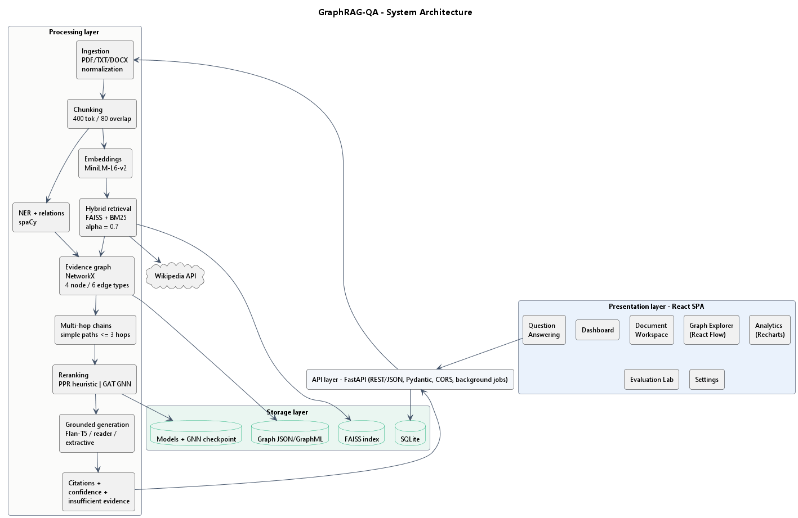
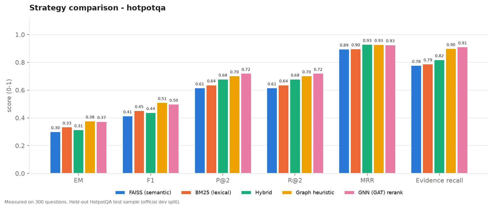
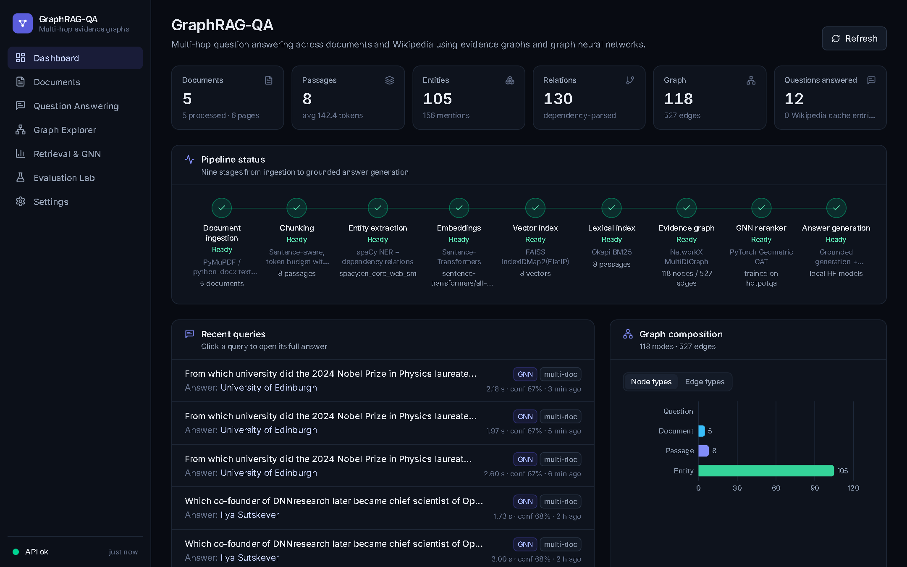
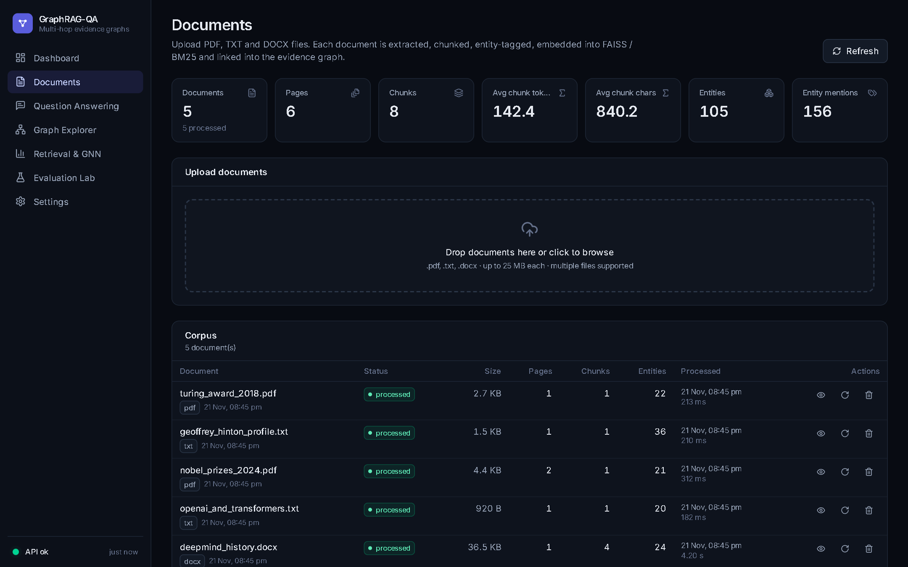
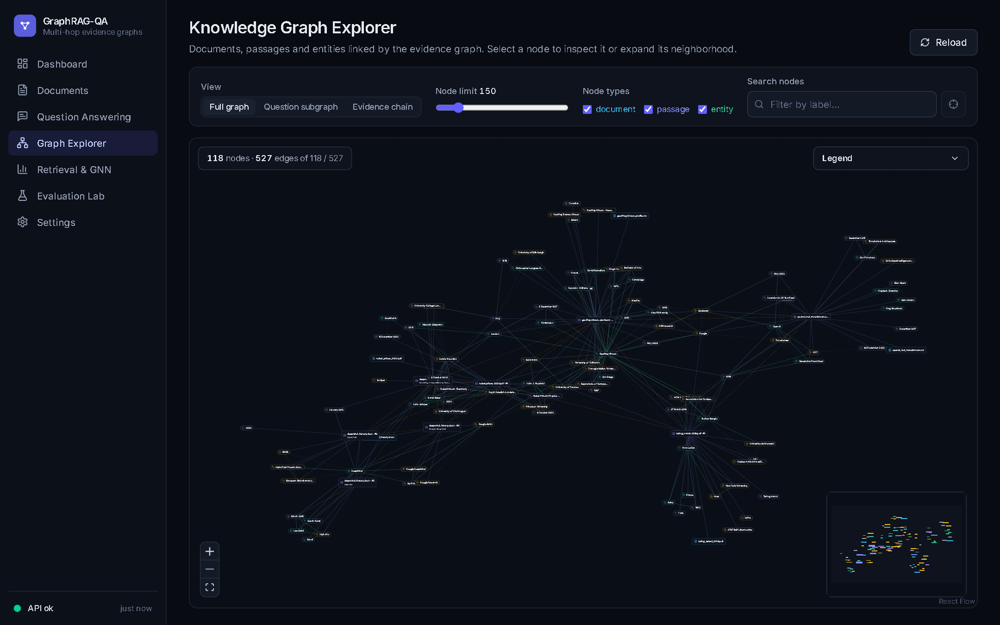
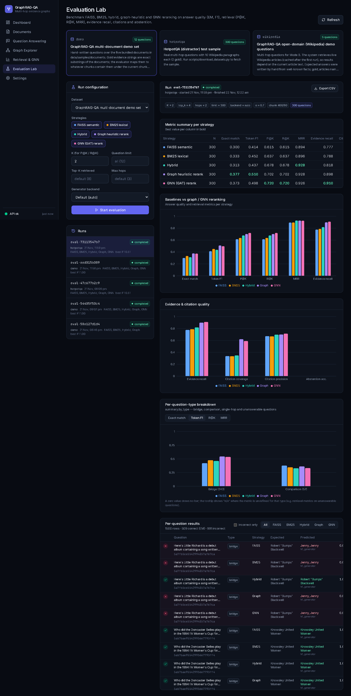

# GraphRAG-QA

**Multi-hop question answering across multiple documents and Wikipedia using evidence graphs and graph neural networks.**

GraphRAG-QA answers questions whose answer is spread over several documents. It
retrieves passages with a hybrid FAISS + BM25 retriever, builds an evidence graph
of documents, passages and named entities, searches the graph for multi-hop
*evidence chains*, reranks evidence with a graph heuristic or a trained Graph
Attention Network (GAT), and generates an answer that is accepted **only if it is
grounded in cited passages** — otherwise it says *"Insufficient evidence found
to answer this question reliably."*

> Example (bundled demo documents): *"From which university did the 2024 Nobel
> Prize in Physics laureate from the University of Toronto receive his PhD?"* —
> the Nobel PDF names Geoffrey Hinton; the Hinton profile (TXT) says his PhD is
> from the University of Edinburgh. GraphRAG-QA links the two through the entity
> *Geoffrey Hinton*, answers **University of Edinburgh**, and cites both
> documents with page numbers and the exact supporting sentences.

---

## Contents
1. [Problem statement](#1-problem-statement) · 2. [Motivation](#2-motivation) · 3. [Objectives](#3-objectives) · 4. [Key features](#4-key-features) · 5. [Technology stack](#5-technology-stack) · 6. [System architecture](#6-system-architecture) · 7. [Workflow](#7-complete-workflow) · 8. [Retrieval](#8-retrieval-methodology) · 9. [Graph construction](#9-graph-construction-methodology) · 10. [GNN](#10-gnn-architecture) · 11. [Ranking maths](#11-mathematical-explanation-of-ranking) · 12. [Datasets](#12-dataset-information) · 13. [Project structure](#13-project-structure) · 14. [Prerequisites](#14-prerequisites) · 15. [Installation](#15-installation) · 16. [Configuration](#16-environment-configuration) · 17. [Backend](#17-start-the-backend) · 18. [Frontend](#18-start-the-frontend) · 19. [Demo](#19-demo-instructions) · 20. [Sample questions](#20-sample-questions) · 21. [Expected behaviour](#21-expected-application-behaviour) · 22. [API](#22-api-documentation) · 23. [Testing](#23-testing) · 24. [Benchmarking](#24-benchmarking) · 25. [Metrics](#25-evaluation-metrics) · 26. [Results](#26-actual-experimental-results) · 27. [Limitations](#27-limitations) · 28. [Future work](#28-future-enhancements) · 29. [References](#29-references) · 30. [Screenshots](#30-screenshots)

---

## 1. Problem statement
Retrieval-augmented generation (RAG) systems retrieve the passages most similar
to a question. Multi-hop questions break this assumption: the passage that
contains the answer ("Hinton completed a PhD at the University of Edinburgh")
is often *not* similar to the question ("…the 2024 Nobel Prize in Physics
laureate from the University of Toronto…"), because the question describes the
bridge entity instead of naming it. The task is to answer such questions over a
user's own document collection or over Wikipedia, combining evidence from
several sources, citing every source, and refusing to answer when the evidence
is insufficient.

## 2. Motivation
* Real questions about reports, papers and policies often need facts from two or more documents.
* Flat top-k retrieval misses "bridge" passages; graphs of shared entities make these connections explicit and explainable.
* Users need to verify answers: citations with page numbers and exact sentences, and an honest "I don't know".
* Graph neural networks can learn which graph neighbourhoods indicate evidence, beyond hand-made heuristics.

## 3. Objectives
1. Ingest PDF/TXT/DOCX files with page-level provenance; chunk, extract entities/relations, embed and index them.
2. Implement semantic (FAISS), lexical (BM25) and hybrid retrieval with configurable weights.
3. Build a heterogeneous evidence graph and search it for multi-hop evidence chains.
4. Implement and **actually train** a GAT reranker; compare it with retrieval and graph-heuristic baselines using measured metrics.
5. Generate grounded answers with fact/inference separation, validated citations and confidence computed from measurable signals.
6. Support open-domain questions over Wikipedia with two-hop article retrieval.
7. Provide a full web application, an evaluation lab, benchmarks, tests and documentation.

## 4. Key features
| Area | What is implemented |
|---|---|
| Ingestion | PDF (PyMuPDF, page numbers), TXT (encoding detection, form-feed pages), DOCX (headings → sections, tables, page breaks); validation, size limit, safe filenames, duplicate detection |
| Chunking | sentence-aware, 400-token budget, 80-token overlap, exact character offsets |
| NLP | spaCy NER, verb-relation extraction, conservative duplicate-entity resolution, entity registry |
| Retrieval | FAISS (persistent, incremental add/remove), BM25, hybrid α·semantic + (1−α)·BM25 |
| Graph | NetworkX heterogeneous graph: 4 node types, 6 edge types; JSON + GraphML serialisation; pruning of hub entities |
| Multi-hop | question subgraph expansion up to 3 hops, simple-path chain search with cycle prevention, scored and explained chains |
| Reranking | Personalized-PageRank graph heuristic; trainable 2-layer GAT (PyTorch Geometric) with negative sampling, validation, early stopping, checkpointing |
| Generation | Flan-T5 (local), extractive reader (local), model-free extractive fallback, optional Ollama / Claude API; grounding check; fact vs inference steps |
| Trust | validated citations (document, page, chunk, exact sentence, scores), confidence from measured signals, insufficient-evidence safeguard |
| Open-domain | Wikipedia search → articles → sections → bridge-entity second hop; SQLite cache |
| UI | 7-page React dashboard: documents, QA, interactive graph explorer (React Flow), analytics (Recharts), evaluation lab with CSV export, settings |
| Quality | pytest suite (unit, integration, end-to-end, frontend contract), reproducible benchmark, OOAD diagrams |

## 5. Technology stack
| Layer | Technology |
|---|---|
| Frontend | React, Vite, TypeScript, Tailwind CSS, React Flow (`@xyflow/react`), Recharts, Lucide icons |
| Backend | Python 3.11+ (tested 3.13), FastAPI, Uvicorn, Pydantic v2 |
| NLP | Sentence-Transformers (`all-MiniLM-L6-v2`), spaCy (`en_core_web_sm`), Hugging Face Transformers (`google/flan-t5-base`, `deepset/tinyroberta-squad2`) |
| Retrieval | FAISS (`faiss-cpu`), `rank_bm25` |
| Graph / GNN | NetworkX, PyTorch, PyTorch Geometric (`GATConv`) |
| Documents | PyMuPDF, python-docx |
| Storage | SQLite (standard library) |
| Testing | pytest, FastAPI TestClient (httpx) |
| Docs | PlantUML + Mermaid diagrams, matplotlib, python-docx, python-pptx |

No Docker, cloud service, paid API or GPU is required.

## 6. System architecture


Full set of OOAD diagrams (use case, class, 6 sequence diagrams, activity,
component, deployment, DFD level 0/1, ER): [`docs/diagrams/rendered/`](docs/diagrams/rendered) ·
explanations: [`docs/architecture.md`](docs/architecture.md).

## 7. Complete workflow
1. **Upload** → validate → store → extract text per page → normalise.
2. **Chunk** (400/80 tokens) → **NER + relations** (spaCy) → **embed** (MiniLM) → **FAISS + BM25** → **entity registry** → **corpus evidence graph** (persisted).
3. **Ask** → question embedding, FAISS/BM25/hybrid scores → question entities → **question subgraph** (seeds + ≤ 3-hop expansion through bridge entities).
4. **Evidence chains** (simple paths) → **graph heuristic** (PPR + chain support) and **GNN** scores (if trained).
5. **Evidence selection** for the chosen strategy → **grounded generation** → **citation validation** → **confidence / insufficient-evidence decision**.
6. Response with answer, fact/inference reasoning, evidence chain, citations, all scores and per-stage timings; query, citations and subgraph are stored for the graph explorer and analytics.

See the activity diagram `docs/diagrams/rendered/activity_qa.png`.

## 8. Retrieval methodology
* **Semantic**: normalised MiniLM embeddings in `faiss.IndexIDMap2(IndexFlatIP)` (exact cosine). Long passages are embedded as the mean of ≤ 180-word sentence windows (the model reads 256 word pieces).
* **Lexical**: BM25 Okapi (k1 1.5, b 0.75) over stemmed, stop-word-filtered terms.
* **Hybrid**: candidates from both; `Hybrid = α·max(0, cos) + (1−α)·BM25/max BM25`, α = 0.7 (configurable).

## 9. Graph construction methodology
Nodes: documents, passages, entities, question. Edges (each backed by extracted
text or metadata): `CONTAINS` (document→passage), `MENTIONS` (passage→entity,
question→entity), `CO_OCCURS_WITH` (same sentence), `RELATED_TO` (verb relation
with its sentence), `SUPPORTS` (retrieved passage→question), `CONNECTS_TO`
(passages sharing a bridge entity, or adjacent chunks). Bridge entities exclude
dates and hub entities (mentioned in more than max(4, min(40, 25 % of passages))
passages). Entity duplicates are merged only by exact normalised form, dropped
middle initials, unique surname, or unique acronym. Details:
[`docs/methodology.md`](docs/methodology.md).

## 10. GNN architecture
`GATReranker` (PyTorch Geometric): input projection (Linear, 392→64) + learned
node-type embedding → **2 × GATConv** (4 heads, edge-type-aware attention,
ReLU, dropout 0.2, residual) → MLP scoring layer over `[h⁰ ‖ h²]` → sigmoid
probability that a passage is supporting evidence. Node features: element-wise
product of the node embedding with the question embedding plus 8 scalars
(cosine, BM25, hybrid, is-seed, hop distance, is-question-entity, log-degree,
entity specificity). Trained on HotpotQA question subgraphs with BCE, half-hard
negative sampling, Adam, early stopping on validation MRR. The GNN is never
used untrained: without a compatible checkpoint the system falls back to the
graph heuristic and says so.

## 11. Mathematical explanation of ranking
* Hybrid: $H(p)=\alpha\,\max(0,\cos(e_q,e_p))+(1-\alpha)\frac{BM25(q,p)}{\max_{p'}BM25(q,p')}$
* Chain: $S(C)=0.45\,\overline{rel}(C)+0.40\,cov_{idf}(C)+0.15\,\overline{bridge}(C)-0.03(|C|-1)$, with $\overline{rel}=0.7\,rel(p_1)+0.3\,\text{mean}(rel(p_{2..n}))$
* Graph heuristic: $G(p)=0.5\,H(p)+0.25\,\frac{PPR(p)}{\max PPR}+0.25\,\frac{\max_{C\ni p}S(C)}{\max_C S(C)}$
* GNN: $P(p)=\sigma\big(\text{MLP}([h^0_p \,\|\, h^2_p])\big)$ with GAT attention $\alpha_{ij}=\text{softmax}_j(\text{LeakyReLU}(a^\top[Wh_i\|Wh_j\|W_ee_{ij}]))$
* Confidence: $0.30\,S_{ret}+0.25\,S_{cov}+0.15\,S_{chain}+0.30\,S_{ans}$ (all measured; see methodology)

## 12. Dataset information
| Dataset | Content | Use |
|---|---|---|
| Demo documents (`data/samples/documents`) | 5 self-written files about AI history: 2 PDF, 2 TXT, 1 DOCX; facts deliberately split across files | demos, tests |
| Demo QA (`data/samples/datasets/demo_qa.json`) | 12 hand-written questions (7 multi-hop incl. 1 comparison, 3 single-hop, 2 unanswerable) with answers, gold documents and gold evidence strings | evaluation (development set) |
| HotpotQA sample (`data/samples/datasets/hotpotqa/`, optional) | distractor setting; 1 000 train + 200 val from the official train split, 300 test from the official dev split (seed 42), plus 2 000 extra training questions (`train_extra.json`, disjoint); CC BY-SA 4.0 | GNN training, held-out evaluation |
| Wikipedia demo (`data/samples/datasets/wikipedia_demo.json`) | 5 open-domain two-hop questions with expected answers | live open-domain demo |

`python scripts/download_datasets.py` fetches the HotpotQA sample through the
Hugging Face datasets-server API (≈ 10 MB); the full 540 MB training file is never downloaded.

## 13. Project structure
```
graphrag-qa/
├── backend/
│   ├── app/
│   │   ├── api/            # FastAPI routers + APIController
│   │   ├── core/           # config, container (composition root), domain model, jobs, timing
│   │   ├── database/       # SQLite schema + repository
│   │   ├── ingestion/      # extractors (PDF/TXT/DOCX), processor, ingestion service
│   │   ├── preprocessing/  # tokenizer, sentence splitter, chunker
│   │   ├── entities/       # spaCy extractor, normaliser, entity registry
│   │   ├── embeddings/     # EmbeddingGenerator (+ hashing fallback)
│   │   ├── retrieval/      # FAISS store, BM25, retrievers, corpus, Wikipedia
│   │   ├── graph/          # evidence graph, builder, traversal, heuristic ranker, layout
│   │   ├── gnn/            # features, GAT model, trainer, ranker, datasets
│   │   ├── generation/     # answer generator + backends, confidence
│   │   ├── citations/      # citation builder/validation
│   │   ├── evaluation/     # metrics, evaluator, benchmark runner
│   │   ├── pipeline/       # GraphReasoner, QAPipeline
│   │   ├── schemas/        # Pydantic API schemas
│   │   └── main.py
│   ├── tests/              # pytest suite
│   └── requirements.txt
├── frontend/               # React + Vite + TypeScript app
├── data/                   # uploads, processed, indexes, graphs, samples (demo docs + datasets)
├── models/                 # embeddings/, generation/ (downloaded), gnn/ (trained checkpoint)
├── scripts/                # setup, download_models, download_datasets, seed_demo, train_gnn,
│                           # run_benchmark, significance_test, make_figures, render_diagrams,
│                           # capture_screenshots, build_report, build_*presentation, package_submission
├── results/                # measured metrics, latency, training history, figures
├── docs/                   # architecture.md, methodology.md, diagrams/, report/, screenshots/,
│                           # presentation/ (15-slide main deck, 24-slide and 68-slide technical decks,
│                           # speaker notes, Viva_Demo_Script.md)
├── README.md · .env.example · requirements.txt · requirements-docs.txt · LICENSE
```

## 14. Prerequisites
* Python **3.11+** (developed and tested with 3.13.2)
* Node.js **20.19+ / 22.12+** (tested with 24.22 LTS) and npm
* ~5 GB free disk (Python packages ≈ 1.5 GB, models ≈ 2.6 GB incl. Flan-T5; ≈ 0.7 GB without it)
* Internet for the first setup (packages, models) and for Wikipedia mode
* Optional: Java 8+ to re-render PlantUML diagrams

## 15. Installation
**Windows (PowerShell)** — from the `graphrag-qa` folder:
```powershell
python -m venv .venv
.\.venv\Scripts\Activate.ps1
python -m pip install --upgrade pip
pip install -r backend\requirements.txt
python scripts\download_models.py --with-generator
python scripts\setup.py
cd frontend; npm install; cd ..
```
If script execution is blocked, run `Set-ExecutionPolicy -Scope Process Bypass` in that PowerShell window first.
If Node.js is missing: `winget install OpenJS.NodeJS.LTS` (or the installer from nodejs.org).

**Linux / macOS (bash)**:
```bash
python3 -m venv .venv
source .venv/bin/activate
python -m pip install --upgrade pip
pip install torch --index-url https://download.pytorch.org/whl/cpu   # Linux: avoids multi-GB CUDA wheels
pip install -r backend/requirements.txt
python scripts/download_models.py --with-generator
python scripts/setup.py
(cd frontend && npm install)
```
`scripts/setup.py` creates the data folders, initialises the database, generates
the sample documents if missing, checks every dependency and model, and seeds
the demo documents. Optional extras: `python scripts/download_datasets.py`
(HotpotQA sample) then `python scripts/train_gnn.py` (trains the GAT on 1 000 questions, ~10 min on a laptop CPU). The shipped model used 3 000: `python scripts/download_datasets.py --extra-train 2000` then `python scripts/train_gnn.py --extra-train` (~30 min).

## 16. Environment configuration
Copy `.env.example` to `.env`. Every setting is optional; the important ones:
* `GRQA_WIKIPEDIA_USER_AGENT` — **required for Wikipedia mode**: Wikimedia rejects requests without contact details (HTTP 403). Put your own site/e-mail, e.g. `GraphRAG-QA/1.0 (https://your-site.example; you@example.com)`.
* `GRQA_GENERATOR_BACKEND` — `auto` (Flan-T5 → reader → extractive), or a fixed backend.
* `GRQA_OLLAMA_MODEL`, `ANTHROPIC_API_KEY` — optional LLM backends (Ollama runs locally; the Claude backend uses the official `anthropic` SDK, `pip install anthropic`).
* Runtime parameters (chunk size, overlap, top-k, hops, α) can also be changed on the Settings page.

## 17. Start the backend
```powershell
cd backend
..\.venv\Scripts\python -m uvicorn app.main:app --host 127.0.0.1 --port 8000
```
```bash
cd backend && ../.venv/bin/python -m uvicorn app.main:app --host 127.0.0.1 --port 8000
```
API docs: <http://127.0.0.1:8000/docs> · health: <http://127.0.0.1:8000/api/health>.
Models load in a background thread at start-up (≈ 5 s); the first answer after start-up also loads Flan-T5 (≈ 2–3 s).

## 18. Start the frontend
```powershell
cd frontend
npm run dev
```
Open <http://127.0.0.1:5173>. The Vite dev server proxies `/api` to port 8000.
Production build: `npm run build` (output in `frontend/dist`, preview with `npm run preview`).

## 19. Demo instructions
**Demo 1 — two-document QA.** Documents page → drag `data/samples/documents/nobel_prizes_2024.pdf` and
`geoffrey_hinton_profile.txt` → wait for *processed* → open a document to see pages, chunks and entities →
Question Answering → ask *"From which university did the 2024 Nobel Prize in Physics laureate from the University
of Toronto receive his PhD?"* → see the answer, fact/inference steps, the two-step evidence chain via *Geoffrey Hinton*,
and click a citation to see the highlighted sentence → *Open in Graph Explorer* to see the highlighted chain.
(`python scripts/seed_demo.py` loads all five sample documents at once.)

**Demo 2 — open-domain.** Set `GRQA_WIKIPEDIA_USER_AGENT` (see §16), restart the backend, choose *Open-domain*, ask
*"Which university did the director of the film Inception study at?"*. The response lists the fetched articles (hop 1 and bridge
hop 2), the chain and section-level Wikipedia citations.

**Demo 3 — GNN comparison.** Analytics page: per-passage FAISS/BM25/hybrid/graph/GNN scores for the last question and rank
changes; GNN training curves. Evaluation Lab: run the `demo` or `hotpotqa` dataset on all five strategies and compare EM, F1,
P@2, R@2, MRR and evidence recall; export CSV.

## 20. Sample questions
| Question | Expected | Needs |
|---|---|---|
| From which university did the 2024 Nobel Prize in Physics laureate from the University of Toronto receive his PhD? | University of Edinburgh | Nobel PDF + Hinton TXT |
| In which city was the AI company co-founded by a 2024 Nobel Prize in Chemistry laureate founded? | London | Nobel PDF + DeepMind DOCX |
| Which co-founder of DNNresearch later became chief scientist of OpenAI? | Ilya Sutskever | Hinton TXT + OpenAI TXT |
| Which award did the scientist who supervised Ilya Sutskever's PhD share with Yann LeCun? | 2018 ACM A.M. Turing Award | Hinton TXT + Turing PDF |
| Which company acquired the London AI lab whose chief executive shared the 2024 Nobel Prize in Chemistry? | Google | Nobel PDF + DeepMind DOCX |
| In which city was the AlphaGo match against Lee Sedol held? | Seoul | DeepMind DOCX |
| Who won the 2030 FIFA World Cup final? | *insufficient evidence* | — |

## 21. Expected application behaviour
* Answers include: final answer, supporting sentence, fact and inference steps, evidence chain with bridge entities, citations (document, page, section, chunk, exact sentence, retrieval/graph/GNN/support scores), retrieved passages with all scores, confidence with its components, evidence coverage, and per-stage timings.
* If documents are missing → HTTP 409 with guidance; Wikipedia unreachable/misconfigured → HTTP 503 with the reason; unsupported question → the insufficient-evidence message plus the failed checks.
* If no trained GNN exists and the GNN strategy is requested, the graph heuristic is used and the response says so.

## 22. API documentation
Interactive OpenAPI docs at `/docs`. Main endpoints:

| Method | Path | Purpose |
|---|---|---|
| POST | `/api/documents/upload` | multipart upload (field `files`), background processing |
| GET | `/api/documents` | list + ingestion statistics |
| GET / DELETE | `/api/documents/{id}` | details (pages, chunks, entities, relations) / delete |
| POST | `/api/documents/{id}/process` | (re)process |
| POST | `/api/qa/ask` | multi-document (or `mode: open_domain`) QA |
| POST | `/api/qa/open-domain` | Wikipedia QA |
| GET | `/api/qa/history`, `/api/qa/{query_id}` | stored answers |
| GET | `/api/graph` | corpus graph (limit, search, node types) with layout |
| POST | `/api/graph/query` | question subgraph / evidence-chain view (`query_id` or `question`) |
| GET | `/api/graph/node/{id}/neighbors` | neighbour expansion |
| GET | `/api/analytics/overview` · `/retrieval` · `/performance` | dashboard, per-strategy scores, measured latencies |
| POST / GET | `/api/evaluation/run` · `/results` · `/results/{id}/csv` · `/datasets` | evaluation lab |
| POST / GET | `/api/gnn/train` · `/api/gnn/status` | training job, checkpoint status + history |
| GET / PUT | `/api/settings` (+ `POST /api/settings/reprocess-all`) | runtime settings, model and storage info |
| GET | `/api/health`, `/api/jobs/{id}` | health, background jobs |

Example:
```bash
curl -X POST http://127.0.0.1:8000/api/qa/ask -H "Content-Type: application/json" \
  -d '{"question":"Which co-founder of DNNresearch later became chief scientist of OpenAI?","strategy":"gnn"}'
```

## 23. Testing
```powershell
cd backend
..\.venv\Scripts\python -m pytest
```
The suite covers PDF/TXT/DOCX ingestion, chunking, NER and entity resolution, embeddings, FAISS insert/search/remove/persist,
BM25, hybrid scoring, graph nodes/edges/serialisation, multi-hop traversal, GNN forward pass/training/checkpoint loading,
answer generation, citation correctness, insufficient-evidence handling, all API endpoints, an end-to-end two-document
workflow, CORS and a frontend↔API contract test. Frontend: `cd frontend && npm run build` (type-checks).

## 24. Benchmarking
```powershell
python scripts\run_benchmark.py
```
Writes `results/latency_results.json`, `results/retrieval_metrics.json`, `results/evaluation_results.csv`,
`results/training_history.json` and charts in `results/figures/`. `--hotpot-limit N` limits HotpotQA questions;
`--skip-eval` measures latency only. Afterwards `python scripts\significance_test.py` computes paired-bootstrap
95% confidence intervals between strategies (`results/significance.json`).

**Submission package.** `python scripts\package_submission.py` writes `../GraphRAG-QA_Submission.zip` without
`.venv`, `node_modules`, downloaded models or runtime data (the database and indexes are re-created by
`scripts/setup.py`). The trained GNN checkpoint, sample data, results and all documents are included.

## 25. Evaluation metrics
EM, token-level F1, Precision@K, Recall@K (K = 2), MRR, evidence recall, citation coverage and precision,
abstention accuracy on unanswerable questions, answer latency and graph-construction latency. Definitions:
[`docs/methodology.md` §12](docs/methodology.md).

## 26. Actual experimental results
All numbers below were produced by `python scripts/run_benchmark.py` on a laptop CPU (Intel Core, 16 logical
cores, 15.6 GB RAM, Windows 11, Python 3.13, no GPU) and are stored in [`results/`](results). They are not
estimates. With exactly two gold paragraphs per HotpotQA question, P@2 and R@2 coincide.

### 26.1 Held-out HotpotQA test sample (300 questions, official dev split, distractor setting)
| Strategy | EM | F1 | P@2 = R@2 | MRR | Evidence recall | Citation coverage | Citation precision | False abstention |
|---|---|---|---|---|---|---|---|---|
| FAISS (semantic) | 0.300 | 0.414 | 0.615 | 0.895 | 0.777 | 0.337 | 0.672 | 0.107 |
| BM25 (lexical) | 0.333 | 0.452 | 0.637 | 0.896 | 0.788 | 0.335 | 0.668 | 0.107 |
| Hybrid (α = 0.7) | 0.313 | 0.437 | 0.678 | **0.928** | 0.818 | 0.348 | 0.697 | 0.097 |
| Graph heuristic | **0.377** | **0.510** | 0.702 | **0.928** | 0.898 | **0.620** | 0.699 | **0.087** |
| GNN (GAT) rerank | 0.373 | 0.498 | **0.720** | 0.926 | **0.910** | 0.590 | **0.714** | 0.097 |

By question type (EM / F1): bridge questions (243) — hybrid 0.337 / 0.463, graph 0.407 / 0.544, GNN 0.407 / 0.536;
comparison questions (57) — hybrid 0.211 / 0.329, graph 0.246 / 0.362, GNN 0.228 / 0.332.



**Reading the results honestly**
* **Graph reasoning helps.** Both graph strategies beat every retrieval-only strategy on answers: EM 0.313 → 0.377 (+6.3 points) for the heuristic and → 0.373 for the GNN, mainly on bridge questions, because evidence chains bring the second-hop paragraph into the generator's context (evidence recall 0.818 → 0.898 / 0.910).
* **The trained GNN has the best ranking scores** (but see the significance test below). P@2 0.720 vs 0.702 (heuristic) and 0.678 (hybrid), and the highest evidence recall (0.910) and citation precision (0.714). Its answer accuracy is on par with the heuristic (EM 0.373 vs 0.377, about one question of 300): with a small Flan-T5 generator, better ranking no longer turns into better answers.
* **Statistical significance** (paired bootstrap over the 300 questions, 10 000 resamples, 95% CI; `python scripts/significance_test.py` → `results/significance.json`): both graph strategies are significantly better than hybrid retrieval on EM, P@2 and evidence recall (e.g. GNN − hybrid: P@2 +0.042 [+0.017, +0.067], evidence recall +0.092 [+0.067, +0.118]). The GNN's lead over the graph heuristic is **not** significant (P@2 +0.018 [−0.003, +0.042], evidence recall +0.012 [−0.007, +0.030], EM −0.003): the two graph rerankers are statistically tied on this sample.
* **Training data is what made the difference** (§26.3): the same GAT trained on 1 000 questions did not beat hybrid ranking (test P@2 0.677, evidence recall 0.875, EM 0.367); with 3 000 questions it does.
* MRR is ≈ 0.93 for all hybrid-based strategies: the first gold paragraph is almost always ranked first; the gains come from the *second* (bridge) paragraph.
* Comparison questions remain hard for every strategy (small models cannot compare dates/values reliably).
* Absolute EM is modest because answers come from Flan-T5-base / a small reader on CPU; published HotpotQA systems use much larger readers.
* Reproducibility note: re-running the benchmark moved the graph-heuristic row by about one question (P@2 0.703 → 0.702) because multithreaded CPU inference is not bit-exact; differences of that size are noise.

### 26.2 Demo multi-document set (12 questions; also used during development — optimistic)
| Strategy | EM | F1 | P@2 | R@2 | MRR | Evidence recall | Citation coverage | Abstention accuracy (2 unanswerable) |
|---|---|---|---|---|---|---|---|---|
| FAISS | 0.90 | 0.90 | 0.60 | 0.75 | 1.00 | 1.00 | 0.60 | 1.00 |
| BM25 | 0.60 | 0.64 | 0.70 | 0.85 | 1.00 | 1.00 | 0.60 | 1.00 |
| Hybrid | 0.70 | 0.70 | 0.75 | 0.90 | 1.00 | 1.00 | 0.60 | 1.00 |
| Graph heuristic | **1.00** | **1.00** | 0.75 | 0.90 | 1.00 | 1.00 | **0.95** | 1.00 |
| GNN | 0.90 | 0.90 | 0.65 | 0.80 | 1.00 | 1.00 | **0.95** | 1.00 |

EM/F1 are computed over the 10 answerable questions; all strategies correctly refused both unanswerable questions.
The GNN misses only the comparison question (DeepMind vs OpenAI founding year).

### 26.3 GNN training and data scaling
| Model (same validation / test sets) | Training questions | Val MRR | Val R@2 | Test P@2 | Test evidence recall | Test EM |
|---|---|---|---|---|---|---|
| Hybrid retrieval (no training) | — | 0.926 | 0.708 | 0.678 | 0.818 | 0.313 |
| Graph heuristic (no training) | — | 0.937 | 0.728 | 0.702 | 0.898 | 0.377 |
| GAT, first run | 1 000 | 0.928 | 0.708 | 0.677 | 0.875 | 0.367 |
| GAT + heuristic score as input (v2) | 1 000 | 0.922 | 0.705 | not evaluated (rejected on validation) | | |
| **GAT, adopted** | **3 000** | **0.947** | **0.753** | **0.720** | **0.910** | 0.373 |

The adopted model (43 210 parameters) was trained on `train.json` (1 000 questions) plus `train_extra.json` (2 000
further questions from the official train split, disjoint from validation and test; `python scripts/download_datasets.py
--extra-train 2000`, then `python scripts/train_gnn.py --extra-train`). 21 epochs with early stopping on validation MRR,
best epoch 13, 179 s of training after ≈ 25 min of graph/feature construction on CPU. Model selection used only the
validation split; each adopted model was evaluated on the test set once. The superseded runs' result files are kept in
[`results/previous_runs/`](results/previous_runs) so every number in this table can be traced.


### 26.4 Latency (mean per question, demo corpus, 12 questions × 3 repeats)
| Stage | Mean |
|---|---|
| Ingestion of 5 sample files (total) | 499 ms |
| Chunking (8 chunks) | 1.2 ms |
| Embedding (per passage) | 27 ms |
| NER + relations (per passage) | 15 ms |
| Corpus graph construction (118 nodes / 527 edges) | 3.1 ms |
| Query embedding | 8.3 ms |
| FAISS search · BM25 · hybrid | 4.0 ms · 0.05 ms · 3.5 ms |
| Question subgraph (avg 57 nodes / 209 edges) | 2.0 ms |
| Evidence-chain traversal (avg top-chain length 1.83) | 3.8 ms |
| Graph heuristic ranking (PPR) | 4.8 ms |
| GNN inference | 12.7 ms |
| Answer generation: extractive · reader · Flan-T5 | 307 ms · 817 ms · 757 ms |

End-to-end answers take about 1–1.5 s on CPU after warm-up; answer generation dominates (graph reasoning adds ≈ 25 ms).
On HotpotQA items (10 paragraphs each) mean answer latency per strategy was 0.87–0.97 s.


### 26.5 Tests
`pytest`: **57 passed** (see §23 and `results/test_results.txt`).

## 27. Limitations
* Small models on CPU: Flan-T5-base and a SQuAD reader are far weaker than large LLMs; comparison and yes/no questions are handled only partially.
* spaCy `en_core_web_sm` makes NER mistakes (e.g. labels an organisation as a person), which can add or remove graph edges.
* Entity linking is string-based (no knowledge-base linking); pronoun coreference is approximated only by adjacency edges and pronoun context in generation.
* Scanned PDFs (images) are not supported (no OCR); DOCX page numbers are logical (page breaks), not rendered pages.
* The GNN was trained on 3 000 HotpotQA questions (Wikipedia paragraphs); behaviour on very different document styles is untested, and its answer accuracy is limited by the small generator rather than by ranking.
* Wikipedia mode depends on network access and a policy-compliant User-Agent; results depend on current article text.
* The demo QA set was used while developing the system, so its scores are optimistic; held-out conclusions should rely on the HotpotQA test sample.

## 28. Future enhancements
Cross-encoder reranking; learned (neural) coreference and entity linking to Wikidata; question decomposition for
comparison questions; training the GNN on more data and jointly with the retriever; OCR for scanned PDFs;
incremental graph updates instead of rebuilds; streaming answers; user authentication and multi-tenant collections.

## 29. References
1. Lewis, P. et al. (2020). Retrieval-Augmented Generation for Knowledge-Intensive NLP Tasks. *NeurIPS*.
2. Yang, Z. et al. (2018). HotpotQA: A Dataset for Diverse, Explainable Multi-hop Question Answering. *EMNLP*.
3. Veličković, P. et al. (2018). Graph Attention Networks. *ICLR*.
4. Kipf, T. N. & Welling, M. (2017). Semi-Supervised Classification with Graph Convolutional Networks. *ICLR*.
5. Hamilton, W., Ying, R. & Leskovec, J. (2017). Inductive Representation Learning on Large Graphs (GraphSAGE). *NeurIPS*.
6. Reimers, N. & Gurevych, I. (2019). Sentence-BERT. *EMNLP-IJCNLP*.
7. Wang, W. et al. (2020). MiniLM: Deep Self-Attention Distillation. *NeurIPS*.
8. Robertson, S. & Zaragoza, H. (2009). The Probabilistic Relevance Framework: BM25 and Beyond. *Foundations and Trends in IR*.
9. Johnson, J., Douze, M. & Jégou, H. (2019). Billion-scale similarity search with GPUs (FAISS). *IEEE Trans. Big Data*.
10. Karpukhin, V. et al. (2020). Dense Passage Retrieval for Open-Domain Question Answering. *EMNLP*.
11. Rajpurkar, P., Jia, R. & Liang, P. (2018). Know What You Don't Know: Unanswerable Questions for SQuAD. *ACL*.
12. Chung, H. W. et al. (2022). Scaling Instruction-Finetuned Language Models (Flan-T5). *arXiv:2210.11416*.
13. Fang, Y. et al. (2020). Hierarchical Graph Network for Multi-hop Question Answering. *EMNLP*.
14. Qiu, L. et al. (2019). Dynamically Fused Graph Network for Multi-hop Reasoning. *ACL*.
15. Asai, A. et al. (2020). Learning to Retrieve Reasoning Paths over Wikipedia Graph for Question Answering. *ICLR*.
16. Xiong, W. et al. (2021). Answering Complex Open-Domain Questions with Multi-Hop Dense Retrieval. *ICLR*.
17. Edge, D. et al. (2024). From Local to Global: A Graph RAG Approach to Query-Focused Summarization. *arXiv:2404.16130*.
18. Gutiérrez, B. J. et al. (2024). HippoRAG: Neurobiologically Inspired Long-Term Memory for LLMs. *NeurIPS*.
19. Page, L. et al. (1999). The PageRank Citation Ranking. Stanford InfoLab; Haveliwala, T. (2002). Topic-Sensitive PageRank. *WWW*.
20. Fey, M. & Lenssen, J. E. (2019). Fast Graph Representation Learning with PyTorch Geometric. *ICLR Workshop*.
21. Honnibal, M. et al. (2020). spaCy: Industrial-strength NLP in Python.
22. Hagberg, A., Schult, D. & Swart, P. (2008). Exploring Network Structure, Dynamics, and Function using NetworkX. *SciPy*.

## 30. Screenshots
Real screenshots of the running application (captured with `python scripts/capture_screenshots.py`):

| | |
|---|---|
|  Dashboard |  Document workspace |
|  Question answering |  Evidence-chain graph |
|  Question subgraph |  Full corpus graph |
|  Retrieval & GNN analytics |  Evaluation lab |
|  Settings | |
