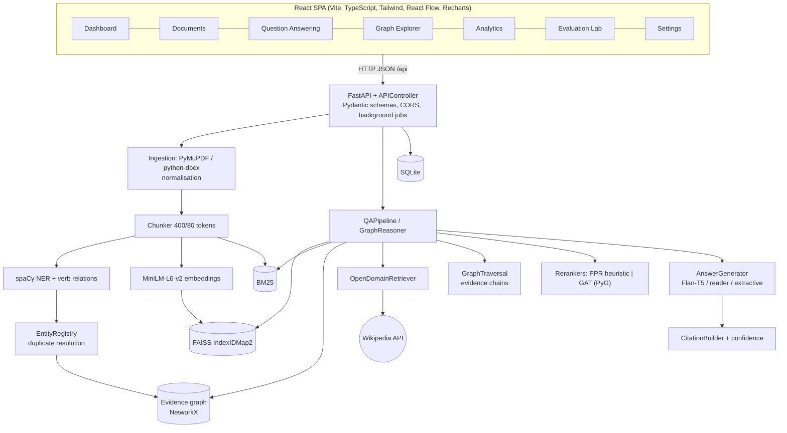
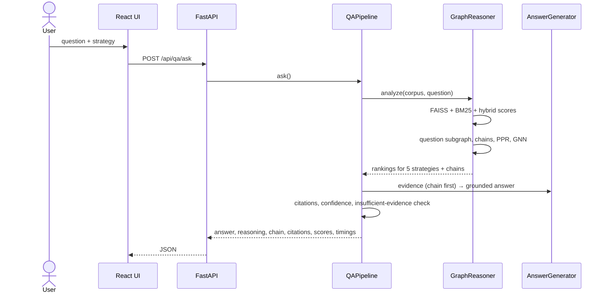
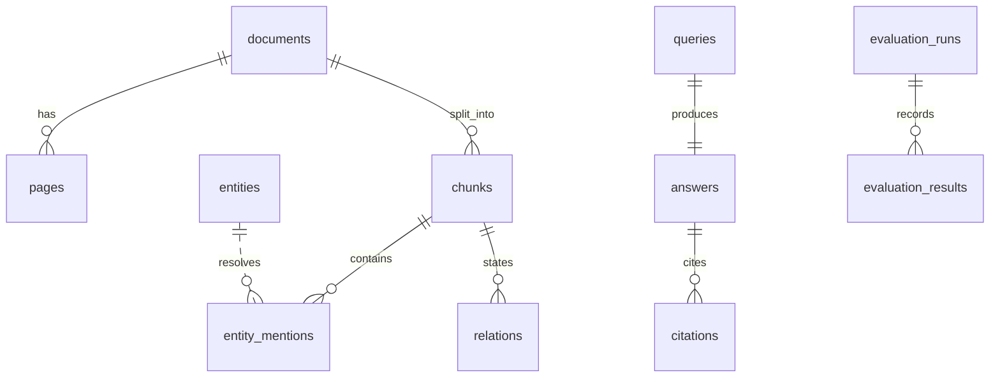

# GraphRAG-QA — Architecture

Rendered PlantUML diagrams live in [`diagrams/rendered/`](diagrams/rendered) (PNG + SVG),
sources in [`diagrams/src/`](diagrams/src). Re-render with `python scripts/render_diagrams.py`.
The Mermaid versions below render directly on GitHub.

| Diagram | File |
|---|---|
| System architecture | `architecture.png` |
| Use cases | `use_case.png` |
| Classes | `class_diagram.png` |
| Sequences A–F | `seq_document_upload.png`, `seq_multidoc_qa.png`, `seq_open_domain.png`, `seq_graph_construction.png`, `seq_gnn_reranking.png`, `seq_answer_generation.png` |
| Activity (QA workflow) | `activity_qa.png` |
| Components | `component.png` |
| Deployment | `deployment.png` |
| Data flow (level 0 / 1) | `dfd_level0.png`, `dfd_level1.png` |
| Entity–relationship | `er_diagram.png` |

## Layers

## Question answering sequence

## Storage

Files on disk: `data/graphrag_qa.sqlite3`, `data/indexes/faiss.index` (+ `.meta.json`
with model id and dimension), `data/graphs/corpus_graph.json|graphml`,
`data/graphs/queries/<query_id>.json` (subgraph + evidence-chain views with node
positions), `models/gnn/gat_reranker.pt` + `training_history.json`.

## Key design decisions

* **One analysis, five strategies.** `GraphReasoner.analyze` computes every score once; FAISS, BM25, hybrid, graph-heuristic and GNN rankings are therefore compared on identical candidates (UI analytics and evaluation).
* **Snapshots.** `CorpusManager` rebuilds an immutable `Corpus` snapshot (registry, BM25, graph) after every document change; queries never see half-updated indexes. Index mutations run in a single-worker job queue.
* **Honest model status.** The GNN is only used when a compatible trained checkpoint exists; otherwise the response says that the graph heuristic was used. Model fallbacks (hashing embedder, regex NER) are reported as *degraded* in `/api/health`.
* **Grounding first.** Generated text never reaches the user unless it is found in the evidence and backed by validated citations; otherwise the insufficient-evidence message is returned with the reasons.
* **Composition root.** `core/container.py` creates each service once (models load once per process); the API, scripts and tests share it.
